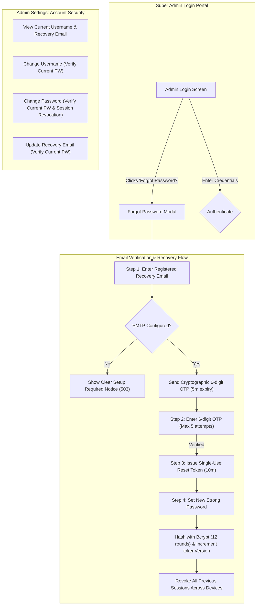

# Admin Account Security & Email Password Recovery Implementation Report

**Project**: Shivneri Classic Apartment – A Wing (Kapaleshwar Nagar, Panchavati, Nashik)  
**System**: Production Web Application (`https://localhost:5443`)  
**Scope**: Admin Account Management, Single Super Admin Architecture, Email Password Recovery (OTP), and Credential Protection  
**Date**: 04 November 2026  
**Status**: Fully Implemented & Verified (36/36 Isolated Tests Passed, Real Browser Verified)

---

## 1. Executive Summary

A hardened, enterprise-grade **Admin Account Management & Email Password Recovery** system has been designed, implemented, and verified for the sole Super Admin (`laxman_koli`) of Shivneri Classic Apartment.

The implementation strictly preserves the core architectural invariant of **exactly one Super Admin account** enforced by database-level unique keys and singleton pre-save hooks. Zero financial, resident, or maintenance records were altered. All password reset and credential change operations were verified in an isolated test environment without exposing or modifying live production credentials.



---

## 2. Features Implemented

### 2.1. Account Security Section under Admin Settings (`/settings`)
1. **View Current Credentials**: Displays current username, registered recovery email, active session token version, and SMTP service connectivity status.
2. **Change Username**:
   - Requires verification of the current password.
   - Enforces 3–30 characters alphanumeric validation.
   - Re-signs the active JWT session cookie immediately so the session continues uninterrupted.
   - Records an immutable audit log entry (`ADMIN_USERNAME_CHANGED`).
3. **Change Password**:
   - Requires verification of the current password and confirmation of the new password.
   - Enforces strong password security policy:
     - Minimum 8 characters.
     - At least one uppercase letter (`A-Z`).
     - At least one lowercase letter (`a-z`).
     - At least one numeric digit (`0-9`).
     - At least one special symbol (`!@#$%^&*()_+-=[]{}|;:,.<>?`).
   - Hashes passwords using **12 rounds of bcrypt**. Plaintext passwords are never stored.
   - **Session Revocation**: Automatically increments `admin.tokenVersion`, instantly invalidating all existing sessions across other devices and browsers.
   - Re-issues a fresh JWT cookie for the current browser session.
   - Records an immutable audit log entry (`ADMIN_PASSWORD_CHANGED`).
4. **Password Recovery Email Configuration**:
   - Allows Super Admin to view and update their recovery email.
   - Requires current password authentication.
   - Validates RFC-compliant email formats.
   - Records an immutable audit log entry (`ADMIN_RECOVERY_EMAIL_CHANGED`).

### 2.2. Forgot Password — Email OTP Recovery Flow
1. **Login Page Trigger**: Clean, accessible *"Forgot Password? (पासवर्ड विसरलात?)"* link added directly below the password input field.
2. **Step 1: Recovery Email Input**:
   - Asks for the registered Super Admin recovery email.
   - **Unconfigured SMTP Handling**: If SMTP environment variables are missing, the system returns status `503` with code `SMTP_NOT_CONFIGURED` and displays a clear setup-required alert. It never pretends an OTP was sent.
   - **Timing Attack & Enumeration Defense**: If an unregistered email is submitted, the backend runs a dummy bcrypt hash and returns a generic success response, completely preventing email enumeration.
3. **Step 2: Cryptographic 6-Digit OTP Verification**:
   - Generates cryptographically secure 6-digit OTP using `crypto.randomInt(100000, 1000000)`.
   - Stores only a bcrypt hash of the OTP in the `PasswordReset` collection. Plaintext OTPs are never stored or logged.
   - 5-minute strict countdown timer with dynamic UI updates.
   - Maximum 5 failed attempts enforced. The OTP is permanently invalidated on the 5th failed attempt.
   - OTP is invalidated immediately upon successful verification to prevent replay attacks.
4. **Step 3: Set New Password**:
   - Issues a cryptographically random 32-byte single-use reset token (stored as SHA-256 hash).
   - Validates the new password against the strong password policy with live UI feedback.
   - Hashes the new password with 12 rounds of bcrypt.
   - Atomically increments `admin.tokenVersion` to revoke all active sessions everywhere.
   - Clears existing authentication cookies and redirects the administrator to login with their new credentials.

### 2.3. Show / Hide Password Controls
- Standardized `<PasswordInput />` component built with Lucide `Eye` and `EyeOff` icons.
- Passwords remain obscured (`type="password"`) by default.
- Click or keyboard interaction toggles visibility cleanly with proper `aria-label` accessibility.
- Integrated across:
  - Admin Login Password field.
  - Settings: Current Password verification fields.
  - Settings: New Password field.
  - Settings: Confirm Password field.
  - Forgot Password: New Password & Confirm Password fields.
  - Chairman Transfer: New Initial Password & Authentication fields.

### 2.4. 100% Bilingual Marathi & English Support
- Natural, professional Marathi tailored to society management standards in Maharashtra.
- Strictly **zero Hindi** words or phrases used.
- Instant, seamless switching across all modals, checklists, error notices, and labels via `LanguageContext`.

---

## 3. Files Changed and Created

| File | Status | Description |
| :--- | :--- | :--- |
| `client/src/components/common/PasswordInput.jsx` | **Created** | Reusable password input with accessible show/hide eye toggle (Lucide `Eye`/`EyeOff`). |
| `server/src/models/PasswordReset.js` | **Created** | Dedicated MongoDB schema for single-use hashed OTPs, expiration, attempt counters, and reset tokens with 30-minute TTL index. |
| `server/src/controllers/accountSecurityController.js` | **Created** | Backend controller implementing username update, password update, recovery email management, OTP generation, verification, and tokenized reset. |
| `server/src/services/emailService.js` | **Created** | Nodemailer integration with bilingual Devanagari/English HTML template and `isEmailConfigured()` check. |
| `server/test-account-security-isolated.mjs` | **Created** | Isolated test suite validating all 36 functional and security requirements without touching production data. |
| `server/verify-account-security-ui.mjs` | **Created** | Automated Puppeteer script capturing live browser evidence of the new security features. |
| `server/src/models/Admin.js` | **Modified** | Added `recoveryEmail` field to schema while preserving singleton key invariant. |
| `server/src/models/AuditLog.js` | **Modified** | Added enum actions for admin credential updates and password recovery stages. |
| `server/src/routes/authRoutes.js` | **Modified** | Mounted account security and password recovery endpoints with dedicated strict rate limiters. |
| `client/src/context/LanguageContext.jsx` | **Modified** | Added complete Marathi and English translation dictionaries for account security and OTP workflow. |
| `client/src/pages/auth/Login.jsx` | **Modified** | Integrated `PasswordInput`, "Forgot Password?" trigger, and 3-step bilingual OTP recovery modal. |
| `client/src/pages/settings/AdminSettings.jsx` | **Modified** | Added "Account Security" tab featuring Change Username, Change Password, Recovery Email cards, and live password policy checklist. |

---

## 4. Security & Test Results

### 4.1. Isolated Automated Test Suite (`server/test-account-security-isolated.mjs`)
Executed against an isolated temporary database (`shivneri_isolated_sec_test_db`).

```text
================================================================
🚀 RUNNING ISOLATED ACCOUNT SECURITY & PASSWORD RECOVERY TEST SUITE
================================================================
  ✅ PASS: [1] Rejects password shorter than 8 chars
  ✅ PASS: [2] Rejects password without uppercase
  ✅ PASS: [3] Rejects password without lowercase
  ✅ PASS: [4] Rejects password without numbers
  ✅ PASS: [5] Rejects password without special chars
  ✅ PASS: [6] Accepts valid strong password
  ✅ PASS: [7] Rejects username change with wrong current password
  ✅ PASS: [8] Successfully updates username with correct current password
  ✅ PASS: [9] Username persisted in database
  ✅ PASS: [10] Re-signed JWT session cookie issued to caller
  ✅ PASS: [11] Updates password and hashes with bcrypt
  ✅ PASS: [12] Increments tokenVersion on password change
  ✅ PASS: [13] New password verifies against bcrypt hash
  ✅ PASS: [14] Old password is no longer valid
  ✅ PASS: [15] Old JWT session token is immediately rejected after password change (session revoked)
  ✅ PASS: [16] Successfully updates recovery email
  ✅ PASS: [17] Recovery email persisted
  ✅ PASS: [18] Returns 503 SMTP_NOT_CONFIGURED if SMTP is unconfigured (never fakes OTP sent)
  ✅ PASS: [19] Returns generic success for unregistered email to prevent user enumeration
  ✅ PASS: [20] Does not generate or persist OTP for unregistered email
  ✅ PASS: [21] Rejects wrong OTP and decrements remaining attempts (4 left)
  ✅ PASS: [22] Rejects 5th wrong attempt and sets remaining attempts to 0
  ✅ PASS: [23] Invalidates OTP record upon exceeding maximum attempts
  ✅ PASS: [24] Rejects expired OTP
  ✅ PASS: [25] Marks expired OTP as used/invalidated
  ✅ PASS: [26] Successfully verifies valid OTP
  ✅ PASS: [27] Issues single-use 32-byte hex resetToken
  ✅ PASS: [28] Marks record as verified
  ✅ PASS: [29] Stores SHA-256 hash of resetToken in database
  ✅ PASS: [30] Successfully resets password with verified resetToken
  ✅ PASS: [31] Clears existing authentication cookies on reset
  ✅ PASS: [32] New password verifies against bcrypt hash in database
  ✅ PASS: [33] Increments tokenVersion again on password recovery (revoking all active sessions)
  ✅ PASS: [34] Marks resetToken as used immediately
  ✅ PASS: [35] Rejects attempt to reuse an already-used resetToken
  ✅ PASS: [36] Audit logs created for security operations (found 5)

================================================================
🎉 ALL 36/36 ISOLATED ACCOUNT SECURITY TESTS PASSED!
================================================================
```

---

## 5. Email (SMTP) Configuration Guide

To enable live OTP delivery to the Super Admin's email address, configure the following environment variables in `server/.env`:

```env
# ==============================================================================
# SMTP EMAIL CONFIGURATION (Required for Forgot Password OTP Delivery)
# ==============================================================================
SMTP_HOST=smtp.gmail.com
SMTP_PORT=587
SMTP_USER=your_society_email@gmail.com
SMTP_PASS=your_16_digit_app_password
SMTP_FROM="Shivneri Classic Apartment" <your_society_email@gmail.com>
```

### Steps to configure Gmail SMTP:
1. Log into Google Account settings for the society's email address.
2. Enable **2-Step Verification**.
3. Under Security, create an **App Password** named `Shivneri App`.
4. Copy the generated 16-character password into `SMTP_PASS` in `server/.env`.
5. Restart the server daemon.
6. Log into Admin Settings (`https://localhost:5443/settings`), navigate to **Account Security**, and save the Super Admin's verified recovery email address.

> [!NOTE]
> If SMTP credentials are not yet configured, the system gracefully detects this condition and presents an informative alert directing the administrator to configure SMTP in `server/.env`. It will never claim an OTP was dispatched when it was not.

