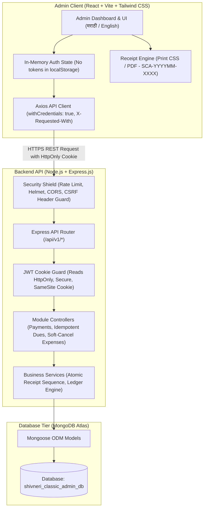
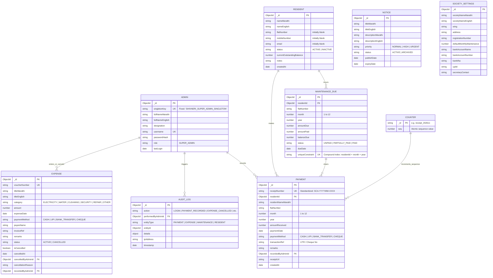
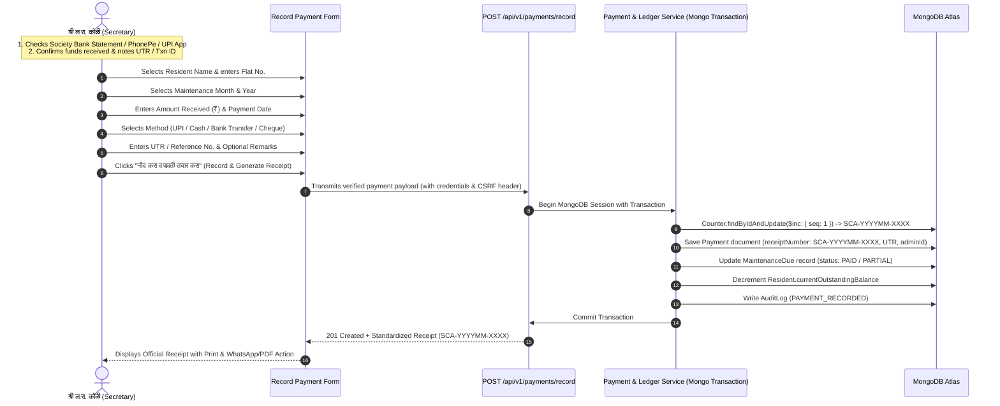

# SHIVNERI CLASSIC APARTMENT – A WING
## Phase 1: Complete Project Architecture & Engineering Plan (Revised)

---

### Executive Summary

| Attribute | Details |
| :--- | :--- |
| **Official Application Name** | **Shivneri Classic Apartment** |
| **Building / Wing** | **A Wing** |
| **Physical Address** | Aurangabad Road, Panchavati, Nashik, Maharashtra, India |
| **Architecture Type** | Single-Admin Apartment Maintenance Management System |
| **Primary Administrator** | **श्री ल.रा. कोळी** (*Shri Laxman Koli*) |
| **Admin Designation** | Chairman / Building Secretary |
| **System Access Model** | **Sole Super Admin Only** (No resident portals, logins, registrations, or secondary accounts) |
| **Technology Stack** | **MERN** (MongoDB Atlas, Express.js, React.js + Vite, Node.js) + Tailwind CSS |
| **Primary Language** | **मराठी (Marathi)** — Default |
| **Secondary Language** | **English** — Secondary (No Hindi anywhere) |
| **Target Database** | `shivneri_classic_admin_db` (Completely Isolated MongoDB Atlas Database) |
| **Document Version** | 1.1.0 (Phase 1 Revised Architecture Blueprint) |

---

## 1. Project Directory Structure

A clean, modular monorepo structure separating the backend API (`server/`) and frontend client (`client/`) within `Shivneri Classic App`.

```
Shivneri Classic App/
│
├── client/                                 # Frontend Application (React + Vite + Tailwind CSS)
│   ├── public/
│   │   ├── favicon.ico
│   │   ├── society-logo.png                # Official Society Crest / Logo
│   │   └── fonts/                          # Marathi / Devanagari webfonts (Noto Sans Devanagari)
│   ├── src/
│   │   ├── assets/                         # SVG icons, crests, background illustrations
│   │   ├── components/                     # Reusable UI components
│   │   │   ├── common/
│   │   │   │   ├── Button.jsx              # Themed buttons with loading states
│   │   │   │   ├── Input.jsx               # Form inputs with Marathi label support
│   │   │   │   ├── Select.jsx              # Select dropdowns
│   │   │   │   ├── Modal.jsx               # Confirmation & action dialogs
│   │   │   │   ├── Table.jsx               # Responsive data table with pagination & search
│   │   │   │   ├── Badge.jsx               # Status indicators (Paid, Unpaid, Active, Inactive, Cancelled)
│   │   │   │   ├── StatCard.jsx            # KPI cards for dashboard
│   │   │   │   └── LanguageSwitcher.jsx    # Marathi / English language selector
│   │   │   ├── layout/
│   │   │   │   ├── AdminLayout.jsx         # Sidebar + Top Header + Breadcrumb + Content shell
│   │   │   │   ├── Sidebar.jsx             # Collapsible navigation drawer
│   │   │   │   ├── Topbar.jsx              # Header with Admin info, date, quick actions
│   │   │   │   └── MobileNav.jsx           # Bottom / drawer navigation for mobile screens
│   │   │   ├── receipts/
│   │   │   │   ├── ReceiptTemplate.jsx     # Official printable/downloadable receipt layout (SCA-YYYYMM-XXXX)
│   │   │   │   └── PrintableReceipt.jsx    # CSS print media stylesheet and print view
│   │   │   └── charts/
│   │   │       ├── MonthlyCollectionChart.jsx  # Monthly fee collection trends
│   │   │       └── ExpenseBreakdownChart.jsx   # Expense categorization donut/bar chart
│   │   ├── context/
│   │   │   ├── AuthContext.jsx             # Admin session state (in-memory; authenticated via HttpOnly cookie)
│   │   │   ├── LanguageContext.jsx         # Marathi / English dictionary provider
│   │   │   └── ToastContext.jsx            # Toast alerts for confirmations and errors
│   │   ├── hooks/
│   │   │   ├── useAuth.js                  # Shortcut to access AuthContext
│   │   │   ├── useLanguage.js              # Access current locale & translation helper (`t()`)
│   │   │   └── useDebounce.js              # Search input debounce hook
│   │   ├── i18n/
│   │   │   ├── mr.json                     # Complete Marathi UI text catalog (Default)
│   │   │   └── en.json                     # Complete English UI text catalog (Secondary)
│   │   ├── pages/
│   │   │   ├── auth/
│   │   │   │   └── Login.jsx               # Admin single-door login portal (no registration link)
│   │   │   ├── dashboard/
│   │   │   │   └── Dashboard.jsx           # Society financial overview & quick actions
│   │   │   ├── residents/
│   │   │   │   ├── ResidentList.jsx        # 16 Master records table + add/edit modals
│   │   │   │   └── ResidentDetail.jsx      # Individual resident ledger & history
│   │   │   ├── maintenance/
│   │   │   │   ├── MaintenanceBilling.jsx  # Idempotent monthly bill generation & due tracker
│   │   │   │   └── DefaultersList.jsx      # Pending arrears & unpaid member list
│   │   │   ├── payments/
│   │   │   │   ├── RecordPayment.jsx       # Secretary manual payment entry form
│   │   │   │   ├── PaymentHistory.jsx      # Master payment audit log
│   │   │   │   └── ReceiptView.jsx         # Official receipt preview & PDF generator
│   │   │   ├── expenses/
│   │   │   │   ├── ExpenseList.jsx         # Society expense vouchers table (Active & Cancelled)
│   │   │   │   ├── AddExpense.jsx          # New expense entry form
│   │   │   │   └── CancelExpenseModal.jsx  # Modal for audited expense cancellation/reversal
│   │   │   ├── notices/
│   │   │   │   └── NoticeBoard.jsx         # Society announcements & notice drafting
│   │   │   ├── reports/
│   │   │   │   ├── FinancialReports.jsx    # Income vs Expense, Monthly Collection Reports
│   │   │   │   └── ResidentLedger.jsx      # Flat-wise printable balance statement
│   │   │   └── settings/
│   │   │       ├── SocietyProfile.jsx      # Name, address, wing, bank account display details
│   │   │       └── AdminSecurity.jsx       # Password change & session termination
│   │   ├── services/
│   │   │   ├── api.js                      # Axios instance with credentials:true & CSRF headers
│   │   │   ├── authService.js              # Login, logout, verify session APIs
│   │   │   ├── residentService.js          # Resident CRUD endpoints
│   │   │   ├── maintenanceService.js       # Dues, idempotent bill generation endpoints
│   │   │   ├── paymentService.js           # Payment recording & receipt endpoints
│   │   │   ├── expenseService.js           # Expense tracking & audited cancellation endpoints
│   │   │   ├── noticeService.js            # Notice endpoints
│   │   │   └── reportService.js            # Financial aggregation endpoints
│   │   ├── utils/
│   │   │   ├── formatters.js               # Currency (₹ INR), Marathi dates, receipt numbers (SCA-YYYYMM-XXXX)
│   │   │   └── pdfGenerator.js             # Client-side PDF rendering helper
│   │   ├── App.jsx                         # Main Router switch & route guards
│   │   ├── main.jsx                        # React root entry point
│   │   └── index.css                       # Tailwind CSS directives & Devanagari typography
│   ├── index.html
│   ├── package.json
│   ├── postcss.config.js
│   ├── tailwind.config.js
│   └── vite.config.js
│
├── server/                                 # Backend Application (Node.js + Express.js + Mongoose)
│   ├── src/
│   │   ├── config/
│   │   │   ├── db.js                       # MongoDB Atlas connection with retry logic
│   │   │   ├── constants.js                # App-wide constants (receipt prefix, months, methods)
│   │   │   └── societyConfig.js            # Default society metadata
│   │   ├── controllers/
│   │   │   ├── authController.js           # Admin login (cookie-based), password update, me, logout
│   │   │   ├── residentController.js       # Resident master CRUD & ledger retrieval
│   │   │   ├── maintenanceController.js    # Idempotent dues generation & balance calculations
│   │   │   ├── paymentController.js        # Manual payment recording & atomic receipt generation
│   │   │   ├── expenseController.js        # Expense entry, category aggregation & audited soft cancellation
│   │   │   ├── noticeController.js         # Notice creation & listing
│   │   │   ├── reportController.js         # Financial statements & summaries
│   │   │   └── settingsController.js       # Society configuration retrieval & updates
│   │   ├── middleware/
│   │   │   ├── authMiddleware.js           # JWT verification from HttpOnly cookie & Admin guard
│   │   │   ├── csrfMiddleware.js           # Custom header validation against Cross-Site Request Forgery
│   │   │   ├── errorMiddleware.js          # Centralized error handler & status codes
│   │   │   ├── rateLimiter.js              # Express rate limiter for brute-force protection
│   │   │   └── validationMiddleware.js     # Request body schema validator (Joi/Zod)
│   │   ├── models/
│   │   │   ├── Admin.js                    # Admin credentials with database-level singleton constraint
│   │   │   ├── Resident.js                 # Resident master schema (16 original records)
│   │   │   ├── MaintenanceDue.js           # Monthly dues with compound unique constraint (residentId+month+year)
│   │   │   ├── Payment.js                  # Confirmed payment transaction & receipt (SCA-YYYYMM-XXXX)
│   │   │   ├── Counter.js                  # Atomic counter collection for zero-collision sequence numbers
│   │   │   ├── Expense.js                  # Society expenditure vouchers with audited soft-cancellation
│   │   │   ├── Notice.js                   # Society notices / updates
│   │   │   ├── SocietySettings.js          # Society profile & configuration
│   │   │   └── AuditLog.js                 # Immutable action trail for financial accountability
│   │   ├── routes/
│   │   │   ├── authRoutes.js               # /api/v1/auth
│   │   │   ├── residentRoutes.js           # /api/v1/residents
│   │   │   ├── maintenanceRoutes.js        # /api/v1/maintenance
│   │   │   ├── paymentRoutes.js            # /api/v1/payments
│   │   │   ├── expenseRoutes.js            # /api/v1/expenses
│   │   │   ├── noticeRoutes.js             # /api/v1/notices
│   │   │   ├── reportRoutes.js             # /api/v1/reports
│   │   │   └── settingsRoutes.js           # /api/v1/settings
│   │   ├── services/
│   │   │   ├── receiptNumberService.js     # Atomic sequential generator for SCA-YYYYMM-XXXX format
│   │   │   └── pdfService.js               # Server-side receipt rendering engine
│   │   ├── utils/
│   │   │   ├── marathiDate.js              # Marathi month & date utilities
│   │   │   └── apiResponse.js              # Standardized API response format
│   │   └── app.js                          # Express app configuration & middleware
│   ├── server.js                           # Entry point & port listener
│   ├── package.json
│   └── .env.example
│
├── phase1_architecture_plan.md             # This comprehensive architecture document
└── README.md                               # Project documentation & operational guidelines
```

---

## 2. Frontend & Backend Architecture

### 2.1 System Architecture Flow



### 2.2 Frontend Architecture Specifications
- **Framework**: React 18+ bootstrapped with Vite for instant HMR and optimized production bundles.
- **Styling**: Tailwind CSS with custom palette (saffron/royal blue accents reflecting regional dignity, clean white/gray cards for clarity).
- **Icons**: Lucide React for consistent, lightweight vector iconography.
- **Routing**: React Router v6 with strict Protected Route wraps (`<AdminRoute>`), redirecting unauthenticated traffic to `/login`.
- **Zero Token in Storage (Anti-XSS)**: Authentication tokens are **never stored in `localStorage` or `sessionStorage`**. The frontend holds only in-memory Admin profile state initialized by calling `/api/v1/auth/me`. The browser automatically includes the `HttpOnly` cookie in cross-origin REST calls.
- **CSRF Defense in Client**: All Axios API instances configure:
  ```javascript
  api.defaults.withCredentials = true;
  api.defaults.headers.common['X-Requested-With'] = 'XMLHttpRequest';
  ```
- **Localization (i18n)**: Lightweight custom React Context (`LanguageContext`) managing Marathi (`mr`) as primary/default and English (`en`) as fallback. No Hindi dictionary included. Instant toggle without page reloads.
- **Receipt Printing & PDF**: Dual-mode receipt engine adhering strictly to `SCA-YYYYMM-XXXX` format:
  1. High-fidelity browser print mode using native `@media print` with crisp 80mm and A4 templates.
  2. Client/Server downloadable PDF receipt for sharing via WhatsApp or direct download.

### 2.3 Backend Architecture Specifications
- **Runtime**: Node.js (LTS v20+) with Express.js.
- **Pattern**: Layered Controller-Service-Repository architecture separating HTTP routing from business logic and database interactions.
- **Cookie-Based JWT Session Management**: Stateless JWT issued directly into an `HttpOnly`, `Secure`, `SameSite=Strict` HTTP cookie with 8-hour expiry. Completely inaccessible to client-side JavaScript.
- **Database Connection**: Mongoose ODM with persistent connection pooling, connection error retry handlers, and auto-indexing enabled in development.
- **Atomic Operations**: MongoDB transactions (`session.withTransaction`) for financial operations (recording payment, incrementing atomic counter, and updating resident maintenance balances simultaneously).

---

## 3. Database Collections & Relationships

The database is isolated inside MongoDB Atlas under the dedicated database name:
**`shivneri_classic_admin_db`**

### 3.1 Entity Relationship Diagram



---

## 4. Admin Authentication & Single Super Admin Protection

### 4.1 Database-Level Single Super Admin Enforcement
To ensure that only one administrator can ever exist, single-admin protection is enforced **at the MongoDB database engine level**, in addition to Mongoose validation.

1. **Singleton Database Constraint**:
   The `Admin` collection defines an immutable singleton field with a unique index:
   ```javascript
   // server/src/models/Admin.js
   const adminSchema = new mongoose.Schema({
     singletonKey: {
       type: String,
       default: 'SHIVNERI_SUPER_ADMIN_SINGLETON',
       unique: true,
       immutable: true,
       required: true
     },
     fullNameMarathi: {
       type: String,
       default: 'श्री ल.रा. कोळी'
     },
     fullNameEnglish: {
       type: String,
       default: 'Shri Laxman Koli'
     },
     designation: {
       type: String,
       default: 'Chairman / Building Secretary'
     },
     username: {
       type: String,
       required: true,
       unique: true,
       trim: true
     },
     passwordHash: {
       type: String,
       required: true
     },
     role: {
       type: String,
       enum: ['SUPER_ADMIN'],
       default: 'SUPER_ADMIN',
       immutable: true
     },
     lastLogin: {
       type: Date,
       default: null
     }
   }, { timestamps: true });

   // Explicit MongoDB unique index on singletonKey guarantees maximum 1 document
   adminSchema.index({ singletonKey: 1 }, { unique: true });
   ```
   **Why this is infallible**: Any attempt by any process, thread, concurrent request, or script to insert a second admin document is immediately aborted by MongoDB with error code `E11000 duplicate key error collection: shivneri_classic_admin_db.admins index: singletonKey_1`.

2. **Idempotent Concurrency-Safe Provisioning**:
   The initial Admin setup script (`npm run seed:admin`) is fully safe against concurrent or repeated execution using an atomic `findOneAndUpdate` with `$setOnInsert`:
   ```javascript
   // server/src/scripts/seedAdmin.js
   await Admin.findOneAndUpdate(
     { singletonKey: 'SHIVNERI_SUPER_ADMIN_SINGLETON' },
     {
       $setOnInsert: {
         singletonKey: 'SHIVNERI_SUPER_ADMIN_SINGLETON',
         fullNameMarathi: 'श्री ल.रा. कोळी',
         fullNameEnglish: 'Shri Laxman Koli',
         designation: 'Chairman / Building Secretary',
         username: process.env.ADMIN_INITIAL_USERNAME,
         passwordHash: await bcrypt.hash(process.env.ADMIN_INITIAL_PASSWORD, 12),
         role: 'SUPER_ADMIN'
       }
     },
     { upsert: true, new: true, setDefaultsOnInsert: true }
   );
   ```
   If executed once, it provisions the Admin. If executed 100 times concurrently, MongoDB's unique index guarantees only one document is created and subsequent runs safely no-op without duplicating records or throwing unhandled errors.

3. **Zero Registration Surface**:
   - Strictly no `/register`, `/signup`, or secondary user creation routes exist in the backend router or frontend views.
   - No mechanism exists to add secondary Admins or staff members.

---

### 4.2 JWT Cookie Security & CSRF Architecture

```mermaid
sequenceDiagram
    autonumber
    actor Admin as श्री ल.रा. कोळी (Secretary)
    participant Client as React Admin Portal (withCredentials: true)
    participant API as Express API (/api/v1/auth)
    participant DB as MongoDB Atlas

    Admin->>Client: Enters Username & Password
    Client->>API: POST /auth/login { username, password }<br/>(Header: X-Requested-With: XMLHttpRequest)
    API->>DB: Admin.findOne({ singletonKey: 'SHIVNERI_SUPER_ADMIN_SINGLETON' })
    DB-->>API: Returns Admin Record
    API->>API: bcrypt.compare(plainPassword, passwordHash)
    
    alt Credentials Invalid
        API-->>Client: 401 Unauthorized ("अवैध वापरकर्तानाव किंवा पासवर्ड")
    else Credentials Valid
        API->>API: Sign JWT (Payload: adminId, role: 'SUPER_ADMIN', expires: 8h)
        API->>DB: Update lastLogin & write AuditLog (LOGIN)
        Note over API,Client: Set-Cookie: token=JWT; HttpOnly; Secure; SameSite=Strict; Max-Age=28800
        API-->>Client: 200 OK + Admin Profile JSON (No token in JSON body)
        Client->>Client: Store Admin Profile in memory AuthContext (Zero LocalStorage)
        Client-->>Admin: Redirect to Dashboard (/dashboard)
    end

    Note over Client,API: Subsequent Mutating Requests (e.g. Record Payment, Cancel Expense)
    Client->>API: POST /api/v1/payments/record<br/>(Browser attaches HttpOnly Cookie + X-Requested-With header)
    API->>API: Verify X-Requested-With header (CSRF defense)
    API->>API: Extract & verify JWT from req.cookies.token
    API->>DB: Process transaction...
```

#### Detailed Security Rules:
1. **Cookie Configuration**:
   ```javascript
   res.cookie('token', token, {
     httpOnly: true,                               // Inaccessible to document.cookie (immunizes against XSS token harvesting)
     secure: process.env.NODE_ENV === 'production', // Transmitted solely over HTTPS
     sameSite: 'strict',                           // Withheld on all cross-site requests (first line of CSRF defense)
     maxAge: 8 * 60 * 60 * 1000,                   // 8 hours shift lifespan
     path: '/'
   });
   ```
2. **Zero Storage in LocalStorage/SessionStorage**:
   The frontend never reads, writes, or persists tokens in `localStorage` or `sessionStorage`. All authenticated state is derived via in-memory React state initialized upon application boot by fetching `/api/v1/auth/me`.
3. **CSRF Mitigation Architecture**:
   - **`SameSite=Strict`**: Browsers reject cookie transmission on any navigation or API call initiated from an external origin.
   - **Custom Header Guard (`csrfMiddleware.js`)**: All state-modifying requests (`POST`, `PUT`, `PATCH`, `DELETE`) require the custom header `X-Requested-With: XMLHttpRequest`. Standard HTML form submissions and cross-site scripts cannot attach custom headers without preflight CORS approval, blocking cross-site request forgery entirely.
4. **Session Invalidation & Logout Behavior**:
   Upon clicking "लॉगआउट" (Logout):
   ```javascript
   // authController.js logout handler
   exports.logout = async (req, res) => {
     await AuditLog.create({
       action: 'LOGOUT',
       performedByAdminId: req.admin._id,
       entityType: 'ADMIN',
       entityId: req.admin._id,
       ipAddress: req.ip
     });
     res.clearCookie('token', {
       httpOnly: true,
       secure: process.env.NODE_ENV === 'production',
       sameSite: 'strict',
       path: '/'
     });
     return res.status(200).json({ success: true, message: 'यशस्वीरीत्या लॉगआउट झाले' });
   };
   ```
   The client resets the in-memory React context and immediately redirects to `/login`.

---

## 5. Resident Master Data Schema & Original 16 Records

### 5.1 Resident Mongoose Schema Specification

```javascript
// server/src/models/Resident.js
const residentSchema = new mongoose.Schema({
  // Preserved Marathi Name (Required, immutable master name)
  nameMarathi: {
    type: String,
    required: [true, 'मराठी नाव आवश्यक आहे'],
    trim: true
  },
  // English Name (Optional, mapped for convenience)
  nameEnglish: {
    type: String,
    trim: true,
    default: ''
  },
  // Flat Number: Initially blank as requested. Nullable, indexed sparsely
  flatNumber: {
    type: String,
    trim: true,
    default: null,
    sparse: true
  },
  // Contact details: Initially blank. No invented data.
  mobileNumber: {
    type: String,
    trim: true,
    default: null
  },
  email: {
    type: String,
    trim: true,
    lowercase: true,
    default: null
  },
  // Status: ACTIVE allows billing, INACTIVE suspends dues generation
  status: {
    type: String,
    enum: ['ACTIVE', 'INACTIVE'],
    default: 'ACTIVE'
  },
  // Cumulative running balance calculated from dues and payments
  currentOutstandingBalance: {
    type: Number,
    default: 0
  },
  // Internal notes by Secretary
  notes: {
    type: String,
    trim: true,
    default: ''
  }
}, { timestamps: true });
```

### 5.2 Initial 16 Resident Master Records Roster

The application is configured to support these 16 resident records with preserved Marathi spelling:

| # | Exact Marathi Name (मराठी नाव) | Initial Flat No. | Initial Mobile | Initial Email | Status |
|:---:|:---|:---:|:---:|:---:|:---:|
| 1 | **श्री संदीप पाटील** | *Blank* | *Blank* | *Blank* | `ACTIVE` |
| 2 | **श्री ल.रा. कोळी** | *Blank* | *Blank* | *Blank* | `ACTIVE` |
| 3 | **श्री नंदकुमार तासकर** | *Blank* | *Blank* | *Blank* | `ACTIVE` |
| 4 | **श्री सिताराम जोपळे** | *Blank* | *Blank* | *Blank* | `ACTIVE` |
| 5 | **श्री विठ्ठल चत्तर** | *Blank* | *Blank* | *Blank* | `ACTIVE` |
| 6 | **श्री सतिष पवार** | *Blank* | *Blank* | *Blank* | `ACTIVE` |
| 7 | **श्री निलेश सानप** | *Blank* | *Blank* | *Blank* | `ACTIVE` |
| 8 | **श्री पंकज देवरे** | *Blank* | *Blank* | *Blank* | `ACTIVE` |
| 9 | **श्री जितेंद्र सूर्यवंशी** | *Blank* | *Blank* | *Blank* | `ACTIVE` |
| 10 | **श्री रविंद्र संगमनेरे** | *Blank* | *Blank* | *Blank* | `ACTIVE` |
| 11 | **श्री पकंज चंद्रभान पवार** | *Blank* | *Blank* | *Blank* | `ACTIVE` |
| 12 | **श्री विलास शिरसाठ** | *Blank* | *Blank* | *Blank* | `ACTIVE` |
| 13 | **श्री आशिष महाजन** | *Blank* | *Blank* | *Blank* | `ACTIVE` |
| 14 | **श्री अजित कदम** | *Blank* | *Blank* | *Blank* | `ACTIVE` |
| 15 | **श्री विनय दत्ता मानकर** | *Blank* | *Blank* | *Blank* | `ACTIVE` |
| 16 | **श्री अे. जी. दिवाण** | *Blank* | *Blank* | *Blank* | `ACTIVE` |

> [!IMPORTANT]
> - These 16 records are master records for accounting and society documentation only.
> - Flat numbers, phone numbers, and emails will NOT be invented or filled with placeholder dummy values. They will remain clean null/blank until the Secretary enters them.
> - Residents will never have accounts or login permissions.

---

## 6. Maintenance Management & Idempotent Dues Generation

### 6.1 Database-Level Duplicate Prevention Constraint
To eliminate any possibility of duplicate monthly bills for the same resident in the same billing cycle, a compound unique index is enforced at the MongoDB database level:

```javascript
// server/src/models/MaintenanceDue.js
const maintenanceDueSchema = new mongoose.Schema({
  residentId: {
    type: mongoose.Schema.Types.ObjectId,
    ref: 'Resident',
    required: true
  },
  flatNumber: {
    type: String,
    default: ''
  },
  month: {
    type: Number, // 1 for January, 12 for December
    required: true,
    min: 1,
    max: 12
  },
  year: {
    type: Number,
    required: true
  },
  amountDue: {
    type: Number,
    required: true,
    min: 0
  },
  amountPaid: {
    type: Number,
    default: 0,
    min: 0
  },
  balanceDue: {
    type: Number,
    required: true
  },
  status: {
    type: String,
    enum: ['UNPAID', 'PARTIALLY_PAID', 'PAID'],
    default: 'UNPAID'
  },
  dueDate: {
    type: Date,
    required: true
  }
}, { timestamps: true });

// COMPOUND UNIQUE INDEX: Completely prevents duplicate monthly records per resident
maintenanceDueSchema.index({ residentId: 1, month: 1, year: 1 }, { unique: true });
```

### 6.2 Idempotent Monthly Bill Generation Engine
Monthly bill generation is designed to be **strictly idempotent**:
```javascript
// maintenanceController.js - Idempotent generator
exports.generateMonthlyDues = async (req, res) => {
  const { month, year, amountDue, dueDate } = req.body;
  const activeResidents = await Resident.find({ status: 'ACTIVE' });

  // Bulk operations with $setOnInsert guarantee idempotency
  const bulkOps = activeResidents.map(resident => ({
    updateOne: {
      filter: { residentId: resident._id, month, year },
      update: {
        $setOnInsert: {
          residentId: resident._id,
          flatNumber: resident.flatNumber || '',
          month,
          year,
          amountDue,
          amountPaid: 0,
          balanceDue: amountDue,
          status: 'UNPAID',
          dueDate: new Date(dueDate)
        }
      },
      upsert: true
    }
  }));

  const result = await MaintenanceDue.bulkWrite(bulkOps);
  // Also increment resident outstanding balance only for newly inserted dues
  if (result.upsertedCount > 0) {
    const upsertedResidentIds = Object.values(result.upsertedIds);
    await Resident.updateMany(
      { _id: { $in: upsertedResidentIds } },
      { $inc: { currentOutstandingBalance: amountDue } }
    );
  }

  return res.status(200).json({
    success: true,
    message: `${month}/${year} महिन्याची देयके यशस्वीरीत्या तपासली/तयार केली`,
    createdCount: result.upsertedCount,
    alreadyExistingCount: result.matchedCount
  });
};
```
If the Secretary clicks "Generate Bills" multiple times for the same month, existing bills remain intact, no duplicate records are generated, no balance double-counting occurs, and no error crashes occur.

---

## 7. Manual Payment Workflow & Atomic Receipt Generation

### 7.1 Standardized Receipt Number Format: `SCA-YYYYMM-XXXX`
All receipt numbers across the system strictly follow the standardized pattern:
**`SCA-YYYYMM-XXXX`**
*(e.g., `SCA-202611-0001` for the first receipt generated in November 2026).*

### 7.2 Atomic Sequence Generation (`Counter` Model)
To guarantee that receipt numbers are **strictly sequential, atomic, and immune to race conditions or duplication**, a dedicated counter collection is utilized:

```javascript
// server/src/models/Counter.js
const counterSchema = new mongoose.Schema({
  _id: { type: String, required: true }, // Format: `receipt_YYYYMM`
  seq: { type: Number, default: 0 }
});
const Counter = mongoose.model('Counter', counterSchema);

// Atomic sequence generation inside payment transaction:
async function generateAtomicReceiptNumber(year, month, session) {
  const periodKey = `receipt_${year}${String(month).padStart(2, '0')}`;
  const counter = await Counter.findByIdAndUpdate(
    periodKey,
    { $inc: { seq: 1 } },
    { new: true, upsert: true, session }
  );
  const sequenceStr = String(counter.seq).padStart(4, '0');
  return `SCA-${year}${String(month).padStart(2, '0')}-${sequenceStr}`;
}
```

### 7.3 Manual Payment Execution Workflow



### 7.4 Payment Mongoose Schema Specification

```javascript
// server/src/models/Payment.js
const paymentSchema = new mongoose.Schema({
  receiptNumber: {
    type: String,
    required: true,
    unique: true // Strictly enforced: SCA-YYYYMM-XXXX (e.g., SCA-202611-0001)
  },
  residentId: {
    type: mongoose.Schema.Types.ObjectId,
    ref: 'Resident',
    required: true
  },
  residentNameMarathi: {
    type: String,
    required: true
  },
  flatNumber: {
    type: String,
    default: '-'
  },
  month: {
    type: Number,
    required: true,
    min: 1,
    max: 12
  },
  year: {
    type: Number,
    required: true
  },
  amountReceived: {
    type: Number,
    required: true,
    min: 1
  },
  paymentDate: {
    type: Date,
    required: true,
    default: Date.now
  },
  paymentMethod: {
    type: String,
    enum: ['UPI', 'CASH', 'BANK_TRANSFER', 'CHEQUE'],
    required: true
  },
  transactionRef: {
    type: String,
    trim: true,
    default: '' // UTR for UPI/IMPS, Cheque No for Cheque, or "CASH-HANDOVER"
  },
  remarks: {
    type: String,
    trim: true,
    default: ''
  },
  recordedByAdminId: {
    type: mongoose.Schema.Types.ObjectId,
    ref: 'Admin',
    required: true
  }
}, { timestamps: true });

paymentSchema.index({ receiptNumber: 1 }, { unique: true });
```

---

## 8. Expense Record Integrity & Audited Soft Cancellation

### 8.1 Zero Hard-Delete Rule for Financial Entries
In compliance with society audit practices, **no financial expense record is ever hard-deleted from the database**. Hard deletion destroys audit trails and creates unexplained discrepancies in society cashbooks.

### 8.2 Audited Soft Cancellation & Reversal Pattern
If an expense voucher is entered erroneously, it undergoes **Audited Soft Cancellation**:
1. The record is flagged with `status: 'CANCELLED'` and `isCancelled: true`.
2. The exact timestamp (`cancelledAt`), the cancelling Administrator (`cancelledByAdminId`), and a **mandatory written reason** (`cancellationReason`) are permanently recorded on the expense document.
3. An immutable entry is written to `AuditLog`.
4. Financial summaries (e.g. Cashbook and Income/Expense reports) automatically exclude cancelled entries from active totals while clearly displaying them in the audit register with strikethrough and cancellation details.

```javascript
// server/src/models/Expense.js
const expenseSchema = new mongoose.Schema({
  voucherNumber: {
    type: String,
    required: true,
    unique: true
  },
  titleMarathi: {
    type: String,
    required: true,
    trim: true
  },
  titleEnglish: {
    type: String,
    trim: true,
    default: ''
  },
  category: {
    type: String,
    enum: ['ELECTRICITY', 'WATER', 'CLEANING', 'SECURITY', 'REPAIR', 'MAINTENANCE', 'OTHER'],
    required: true
  },
  amount: {
    type: Number,
    required: true,
    min: 0.01
  },
  expenseDate: {
    type: Date,
    required: true,
    default: Date.now
  },
  paymentMethod: {
    type: String,
    enum: ['CASH', 'UPI', 'BANK_TRANSFER', 'CHEQUE'],
    required: true
  },
  payeeName: {
    type: String,
    required: true,
    trim: true
  },
  invoiceRef: {
    type: String,
    trim: true,
    default: ''
  },
  remarks: {
    type: String,
    trim: true,
    default: ''
  },
  recordedByAdminId: {
    type: mongoose.Schema.Types.ObjectId,
    ref: 'Admin',
    required: true
  },
  // AUDITED SOFT CANCELLATION FIELDS (Zero Permanent Deletion)
  status: {
    type: String,
    enum: ['ACTIVE', 'CANCELLED'],
    default: 'ACTIVE'
  },
  isCancelled: {
    type: Boolean,
    default: false
  },
  cancelledAt: {
    type: Date,
    default: null
  },
  cancelledByAdminId: {
    type: mongoose.Schema.Types.ObjectId,
    ref: 'Admin',
    default: null
  },
  cancellationReason: {
    type: String,
    trim: true,
    default: null
  }
}, { timestamps: true });
```

---

## 9. Official Receipt Specifications

The official receipt serves as a legal, formal proof of maintenance payment in Maharashtra society governance standards.

### 9.1 Receipt Content Elements
1. **Header**:
   - **शिवनेरी क्लासिक अपार्टमेंट (ए विंग)**
   - *Shivneri Classic Apartment (A Wing)*
   - पत्ता: औरंगाबाद रोड, पंचवटी, नाशिक, महाराष्ट्र.
2. **Standardized Receipt Metadata**:
   - पावती क्रमांक (Receipt No): **`SCA-YYYYMM-XXXX`** *(उदा. `SCA-202611-0001`)*
   - दिनांक (Date): `DD/MM/YYYY`
3. **Resident Details**:
   - सभासदाचे नाव (Member Name): [Resident Marathi Name]
   - सदनिका क्र. (Flat No): [Flat Number]
4. **Financial Breakdown**:
   - महिना व वर्ष (Maintenance Period): [उदा. नोव्हेंबर २०२६ / November 2026]
   - मिळालेली रक्कम (Amount Received): `₹ X,XXX /-`
   - अक्षरी रक्कम (Amount in Words): [मराठी आणि इंग्रजी अक्षरी]
   - भरणा पद्धत (Payment Mode): UPI / Cash / Bank Transfer / Cheque
   - UTR / व्यवहार संदर्भ क्र. (UTR / Reference No.): [UTR Number]
   - शेरा (Remarks): [Notes]
5. **Sign-off**:
   - **श्री ल.रा. कोळी** (चेअरमन / सेक्रेटरी)
   - Shivneri Classic Apartment – A Wing Society Seal Placeholder

---

## 10. Complete Application Route List (Frontend)

| Path | Page Component | Access | Purpose / Description |
| :--- | :--- | :--- | :--- |
| `/login` | `Login.jsx` | Public | Single Super Admin login screen (no registration link) |
| `/` | `Dashboard.jsx` | Protected | Redirects to `/dashboard` |
| `/dashboard` | `Dashboard.jsx` | Protected | Key society metrics, recent payments, pending balance list |
| `/residents` | `ResidentList.jsx` | Protected | Roster of 16 residents, balance status, edit modal |
| `/residents/:id` | `ResidentDetail.jsx` | Protected | Resident ledger, month-by-month payment history |
| `/maintenance` | `MaintenanceBilling.jsx` | Protected | Idempotent monthly fee generator & due tracker |
| `/maintenance/defaulters` | `DefaultersList.jsx` | Protected | Arrears & outstanding payment dues list |
| `/payments/record` | `RecordPayment.jsx` | Protected | Primary Secretary form: Record payment & issue receipt |
| `/payments` | `PaymentHistory.jsx` | Protected | Searchable table of all payments & UTR numbers |
| `/payments/receipt/:id` | `ReceiptView.jsx` | Protected | Official printable & downloadable PDF receipt view (`SCA-YYYYMM-XXXX`) |
| `/expenses` | `ExpenseList.jsx` | Protected | Society expenditure logbook (Active & Cancelled status) |
| `/expenses/new` | `AddExpense.jsx` | Protected | New expense voucher entry form |
| `/notices` | `NoticeBoard.jsx` | Protected | Society notice creation, listing & printing |
| `/reports` | `FinancialReports.jsx` | Protected | Income vs Expense statement, collection trends |
| `/reports/ledger` | `ResidentLedger.jsx` | Protected | Society master ledger for audits & AGM meetings |
| `/settings` | `SocietyProfile.jsx` | Protected | Society bank details, address, default maintenance fee |
| `/settings/security` | `AdminSecurity.jsx` | Protected | Admin password change & session termination |

---

## 11. Complete API Endpoint List (Backend)

Base URL: `/api/v1`

### 11.1 Authentication (`/auth`)
- `POST /auth/login` — Authenticate Admin credentials, set `HttpOnly` Secure cookie, return Admin profile.
- `GET /auth/me` — Verify active cookie session and return Admin profile details.
- `PUT /auth/change-password` — Update Admin password (requires current password).
- `POST /auth/logout` — Clear `HttpOnly` cookie and record logout audit log.

*(Strictly no registration, sign-up, or secondary admin endpoints).*

### 11.2 Residents (`/residents`)
- `GET /residents` — Retrieve all resident master records (supports status filter).
- `GET /residents/:id` — Get single resident details with complete payment ledger.
- `POST /residents` — Add a new resident record (if apartment occupancy changes).
- `PUT /residents/:id` — Update resident flat number, mobile, email, or notes.
- `PATCH /residents/:id/status` — Toggle resident status (`ACTIVE` / `INACTIVE`).

### 11.3 Maintenance Dues (`/maintenance`)
- `GET /maintenance/dues` — Query dues by month and year.
- `POST /maintenance/generate-monthly` — **Idempotent endpoint**: Generate monthly maintenance dues for active residents without duplicating.
- `GET /maintenance/defaulters` — List all members with outstanding unpaid balances.
- `GET /maintenance/summary` — Aggregate summary of total billed, total collected, and total pending.

### 11.4 Payments & Receipts (`/payments`)
- `POST /payments/record` — **Core Endpoint**: Record verified payment, atomically issue `SCA-YYYYMM-XXXX` receipt, adjust balance.
- `GET /payments` — Search and paginate payment history (filter by date, flat, method, UTR).
- `GET /payments/:id` — Retrieve full payment details.
- `GET /payments/receipt/:receiptNumber` — Fetch receipt payload for display or PDF print.
- `GET /payments/export/csv` — Export payment register to CSV for society accounting.

### 11.5 Society Expenses (`/expenses`)
- `GET /expenses` — List all expense vouchers (supports status filter: `ALL`, `ACTIVE`, `CANCELLED`).
- `POST /expenses` — Record a new society expense voucher.
- `GET /expenses/:id` — Retrieve voucher details.
- `PATCH /expenses/:id/cancel` — **Audited soft-cancellation endpoint**: Marks expense as cancelled with mandatory reason, preserving the record. *(Permanent hard deletion is strictly forbidden).*

### 11.6 Notices (`/notices`)
- `GET /notices` — List society notices (active and archived).
- `POST /notices` — Publish a new notice (Bilingual Marathi / English support).
- `PUT /notices/:id` — Edit an existing notice.
- `PATCH /notices/:id/archive` — Archive an expired notice.

### 11.7 Reports & Analytics (`/reports`)
- `GET /reports/dashboard-stats` — Top-line summary counts for quick dashboard loading.
- `GET /reports/monthly-collection` — Month-by-month collection statistics for graphs.
- `GET /reports/annual-ledger` — Comprehensive annual balance sheet (Income vs Active Expenditure).

### 11.8 Society Settings (`/settings`)
- `GET /settings` — Get society profile, bank details, and default maintenance configuration.
- `PUT /settings` — Update society settings (Secretary contact, bank details, etc.).

---

## 12. Security Architecture & Isolation Summary

```mermaid
flowchart LR
    subgraph ClientProtection ["Client Security"]
        XSS["React DOM escaping (Anti-XSS)"]
        NoStorage["Zero tokens in localStorage/sessionStorage"]
        CsrfHeader["X-Requested-With header on all API calls"]
    end

    subgraph TransportProtection ["Transport & Gateway"]
        TLS["HTTPS / TLS 1.3"]
        CorsGuard["Strict CORS Whitelist (client origin only)"]
        CookieSecurity["HttpOnly, Secure, SameSite=Strict Cookie"]
        RateLimit["Rate Limiting (5 login attempts / 15 min)"]
    end

    subgraph AppProtection ["API Layer Security"]
        Helmet["Helmet Security Headers"]
        Sanitize["NoSQL Injection Sanitization"]
        JwtVerify["HMAC-SHA256 JWT Verification from Cookie"]
        CsrfFilter["CSRF Header Validation Middleware"]
        InputVal["Strict Joi/Zod Request Validation"]
    end

    subgraph DataProtection ["Data Tier Security (shivneri_classic_admin_db)"]
        SingletonUK["Database Unique Index on singletonKey (Single Admin Max)"]
        DueUK["Compound Unique Index (residentId+month+year)"]
        AtomicCounter["Atomic Sequence Increment (SCA-YYYYMM-XXXX)"]
        SoftDelete["Soft-Delete Only for Financial Expenses"]
        Bcrypt["bcrypt Hashing (12 Salt Rounds)"]
        Audit["Immutable AuditLog on all Financial Events"]
    end

    ClientProtection --> TLS --> TransportProtection --> AppProtection --> DataProtection
```



---

## 13. Bilingual Localization (Marathi & English)

### 13.1 Language Hierarchy
- **Default Language**: **मराठी (Marathi)**. All primary UI headers, action buttons, receipt fields, and notifications load in Marathi on first visit.
- **Secondary Language**: **English**. Can be toggled at any moment via a persistent header switch.
- **Strict Rule**: No Hindi strings, keys, or translations exist anywhere in the code.

### 13.2 Core Glossary Mappings

| Marathi (मराठी) - Primary | English - Secondary | Application Context |
| :--- | :--- | :--- |
| शिवनेरी क्लासिक अपार्टमेंट (ए विंग) | Shivneri Classic Apartment (A Wing) | Header / Brand |
| मुख्य नियंत्रण कक्ष | Dashboard | Navigation |
| सभासद यादी | Resident Master List | Navigation / Header |
| मासिक देखभाल फी | Monthly Maintenance | Module Title |
| पावती नोंदणी व पावती तयार करा | Record Payment & Generate Receipt | Core Action Button |
| पावती इतिहास | Payment History | Module Title |
| खर्च नोंदवही | Expense Ledger | Module Title |
| खर्च रद्द करा (कारणासह) | Cancel Expense (With Reason) | Audited Action |
| सूचना फलक | Notice Board | Module Title |
| आर्थिक अहवाल | Financial Reports | Module Title |
| शिल्लक / येणे बाकी | Outstanding Balance / Arrears | Table Column / KPI |
| भरलेली रक्कम | Amount Received | Form Field |
| भरणा पद्धत (रोख / यूपीआय / बँक / धनादेश) | Mode (Cash / UPI / Bank / Cheque) | Form Select |
| व्यवहार संदर्भ क्र. (UTR) | Transaction Ref / UTR No. | Form Field |
| पावती क्रमांक (SCA-YYYYMM-XXXX) | Receipt Number (SCA-YYYYMM-XXXX) | Formal Receipt Spec |
| पावती प्रत (डाउनलोड / प्रिंट) | Receipt Copy (Download / Print) | Action Button |

---

## 14. Development Roadmap (Phases)

| Phase | Title | Scope of Work | Status |
| :---: | :--- | :--- | :---: |
| **Phase 1** | **Architecture & Planning (Revised)** | Specifications, directory design, schemas, single-admin DB guard, HttpOnly cookies, atomic receipt numbering, soft-delete expense model, idempotent dues | **COMPLETED & REVISED** |
| **Phase 2** | **Project Scaffolding & Setup** | Vite + React frontend setup, Express backend setup, Tailwind config, clean git init | *Awaiting Approval* |
| **Phase 3** | **Admin Security & Authentication** | Mongo connection (`shivneri_classic_admin_db`), Admin model with singleton constraint, idempotent seed script for श्री ल.रा. कोळी, HttpOnly cookie JWT auth | *Pending* |
| **Phase 4** | **Resident Master & Seeding** | Resident schema, seed 16 original Marathi resident records, resident management UI | *Pending* |
| **Phase 5** | **Monthly Maintenance Engine** | Idempotent billing cycle generation with compound unique index, arrears computation, balance tracking | *Pending* |
| **Phase 6** | **Manual Payment & Official Receipts** | "Record Payment & Generate Receipt" module, atomic sequence counter, standardized `SCA-YYYYMM-XXXX` PDF receipts | *Pending* |
| **Phase 7** | **Expense & Cashbook Management** | Society expense vouchers, categorization, audited soft-cancellation with mandatory reason, balance reconciliation | *Pending* |
| **Phase 8** | **Reports, Analytics & Bilingual UI** | Marathi/English i18n, collection trend charts, printable ledger statements | *Pending* |
| **Phase 9** | **End-to-End Verification & Launch** | Full user-flow testing, mobile responsiveness audit, production build check | *Pending* |

---

## 15. Phase 1 Sign-Off & Next Steps

This revised Phase 1 architecture plan fully integrates all 5 mandatory corrections:
1. Database-level single Super Admin protection via unique singleton key index & safe idempotent provisioning.
2. HttpOnly, Secure, SameSite cookie-based JWT authentication with zero token storage in browser storage, plus CSRF header defense.
3. Standardized `SCA-YYYYMM-XXXX` receipt number format backed by an atomic sequence Counter collection.
4. Audited soft-cancellation model for society expense records with mandatory reason and Admin logging (no permanent deletions).
5. Idempotent monthly maintenance due generation enforced by a compound unique database constraint `(residentId, month, year)`.

As instructed:
- No code has been executed yet.
- No database connection to MongoDB Atlas has been initiated yet.
- No login credentials or resident records have been populated yet.
- Previous projects remain entirely isolated and untouched.

*Awaiting user approval of the revised `phase1_architecture_plan.md` before proceeding to Phase 2.*
