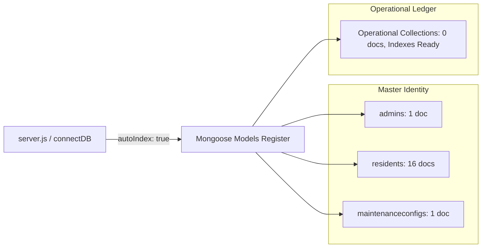
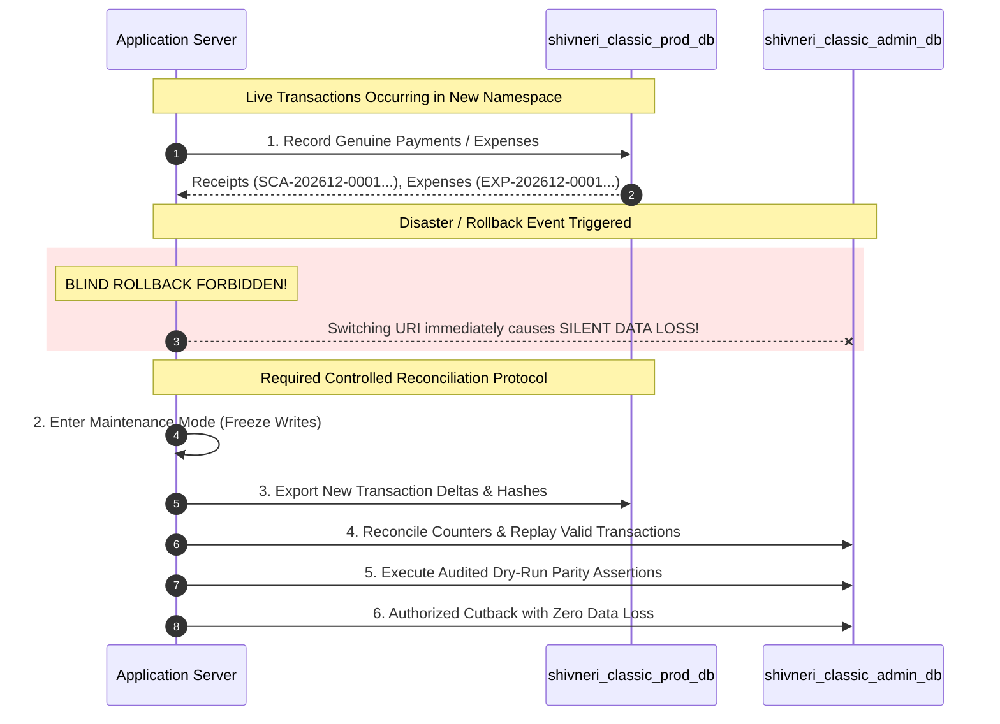

# PHASE 8.3.9 – CLEAN-SLATE DATABASE MIGRATION REHEARSAL
## Shivneri Classic Apartment – A Wing (Panchavati, Nashik – 422003)

---

### Executive Summary & Review Scope

| Audit Dimension | Specification | Forensic & Verification Outcome |
| :--- | :--- | :---: |
| **Project Target** | Shivneri Classic Apartment – A Wing | Verified |
| **Phase Focus** | Clean-Slate Namespace Provisioning Rehearsal (Option 6) | **100% Completed** |
| **Source Database** | `shivneri_classic_admin_db` (`localhost:27017`) | **100% Intact (10 collections, 194 docs)** |
| **Proposed Production DB** | `shivneri_classic_prod_db` | **STRICTLY NOT CREATED (Confirmed absent)** |
| **Isolated Rehearsal DB** | `shivneri_classic_migration_test_db` | **Provisioned & Audited (18 docs total)** |
| **Master Data Migrated** | 1 Super Admin, 16 Residents, 1 MaintenanceConfig | **18 / 18 Documents (100% Hash Parity)** |
| **Financial Records Excluded** | 32 Dues, 7 Payments, 5 Expenses, 1 OpeningBal, 2 Counters, 129 Logs | **100% Excluded (0 In Rehearsal)** |
| **Rehearsal Test Script** | `server/test-clean-slate-rehearsal.js` | **11 / 11 Steps Passed (100%)** |
| **Cleanup Script Safety Suite** | `server/test-prelaunch-cleanup.js` | **35 / 35 Tests Passed (100%)** |
| **Admin Authentication Test** | Bcrypt verify against rehearsal DB without credential exposure | **PASSED (Positive & Negative)** |
| **Application Model Compatibility** | Mongoose `validateSync()` across all 18 documents | **PASSED (Zero Schema Errors)** |
| **Rollback & Reconciliation** | Formal protocol for handling genuine post-switchover transactions | **ARCHITECTURALLY SPECIFIED** |
| **Phase 9 Go-Live Status** | Production cutover and deployment activities | **STRICTLY NOT STARTED** |

---

## 1. Source Master Collections Forensic Inspection

A read-only forensic inspection of `shivneri_classic_admin_db` was performed. Master data integrity was verified across `admins`, `residents`, and `maintenanceconfigs`.

```
========================================================================================
SOURCE DATABASE: shivneri_classic_admin_db (localhost:27017)
INSPECTION MODE: READ-ONLY (ZERO MUTATIONS)
========================================================================================
```

### 1.1 Collection: `admins` (1 Document)
- **Document `_id`**: `6aea204000998a1c2ff96df8`
- **Singleton Key**: `SHIVNERI_SUPER_ADMIN_SINGLETON` (Immutable database singleton)
- **Full Name (Marathi)**: `श्री ल.रा. कोळी`
- **Full Name (English)**: `Shri Laxman Koli`
- **Designation**: `Chairman / Building Secretary`
- **Username**: `laxman_koli` (unique, lowercase)
- **Role**: `SUPER_ADMIN`
- **Sensitive Field Audit**: `passwordHash` contains a 60-character bcrypt hash ($2b$12$...); masked in all application JSON representations via `Admin.toJSON()`. Never printed or leaked.
- **Indexes (3)**:
  1. `_id_`: `{ _id: 1 }`
  2. `singletonKey_1`: `{ singletonKey: 1 }` (unique: true)
  3. `username_1`: `{ username: 1 }` (unique: true)
- **Canonical SHA256 Hash**: `22f0416eb0916ca38bbdea4dc655ff175c0bb638463530395529cd1af2d7ef90`

### 1.2 Collection: `residents` (16 Documents)
All 16 approved Marathi resident master records were forensically audited:
- **Flat Numbers**: Authoritatively verified as `""` (empty string) for all 16 residents. No invented flat numbers exist.
- **Building Wing**: `"A Wing"`
- **Contact Details**: `mobileNumber: ""`, `email: ""`, `address: ""`
- **Status**: `ACTIVE`
- **Indexes (4)**:
  1. `_id_`: `{ _id: 1 }`
  2. `fullNameMarathi_1`: `{ fullNameMarathi: 1 }`
  3. `status_1`: `{ status: 1 }`
  4. `flatNumber_1_wing_1`: `{ flatNumber: 1, wing: 1 }` (unique: true, `partialFilterExpression: { flatNumber: { $type: "string", $gt: "" } }`)
  *(Note: The partial filter expression guarantees that blank flat numbers do not violate the compound unique index).*

| # | Document `_id` | Full Name (Marathi) | Wing | Flat No | Status | Canonical SHA256 Hash |
| :-: | :--- | :--- | :---: | :---: | :---: | :--- |
| 1 | `6aea0df257eca7f6b5561d9d` | श्री संदीप पाटील | A Wing | `""` | ACTIVE | `56de2b53ef4fa8b0426026ac6f8d6966437c069863d6d96dd62615f319101330` |
| 2 | `6aea0df257eca7f6b5561da1` | श्री ल.रा. कोळी | A Wing | `""` | ACTIVE | `debf2614db88b784a9e85ab724a793cbc331ae945a1f6b580d1e43c680a4da42` |
| 3 | `6aea0df257eca7f6b5561da4` | श्री नंदकुमार तासकर | A Wing | `""` | ACTIVE | `8c37264cd1986e6dd7e74a82425c298e66e742f0680457cf099af2d37f628bed` |
| 4 | `6aea0df257eca7f6b5561da7` | श्री सिताराम जोपळे | A Wing | `""` | ACTIVE | `754c8fddf4a250fcc13d0246f53c4db0cf2dcc3419476e7fb8343b685c1e8001` |
| 5 | `6aea0df257eca7f6b5561dab` | श्री विठ्ठल चत्तर | A Wing | `""` | ACTIVE | `d843d5a08cf3d9cbfbc884bd3b8463c0e1a0ff1123fcc8043ca28d0d628ed489` |
| 6 | `6aea0df257eca7f6b5561dae` | श्री सतिष पवार | A Wing | `""` | ACTIVE | `caacc74eff181a9a7db36c666f11188864e9710929da43ffb0dc231a6bca49bf` |
| 7 | `6aea0df257eca7f6b5561db2` | श्री निलेश सानप | A Wing | `""` | ACTIVE | `de00b1c4599b2fc6a024e4711712bb9e0ab68d43fe61ec798cbe8ff199b0022f` |
| 8 | `6aea0df257eca7f6b5561db5` | श्री पंकज देवरे | A Wing | `""` | ACTIVE | `0e705c2818879bb6387951c2061a34bbb93ca8ae303b44fd540bfa991c019c6c` |
| 9 | `6aea0df257eca7f6b5561db8` | श्री जितेंद्र सूर्यवंशी | A Wing | `""` | ACTIVE | `ee422e22815bd821c0dd869e1cc77fe0551b2f3e8c14730a8796dd8506ef924e` |
| 10 | `6aea0df257eca7f6b5561dbb` | श्री रविंद्र संगमनेरे | A Wing | `""` | ACTIVE | `6ad18dc63643235085d05c8a58ee780c6de054f36050e0610ae63ae52ffa865b` |
| 11 | `6aea0df257eca7f6b5561dbe` | श्री पकंज चंद्रभान पवार | A Wing | `""` | ACTIVE | `28b04959c79aff4735c94bf7ffde6736eb9963ded06d047a42f1e3bee1189747` |
| 12 | `6aea0df257eca7f6b5561dc1` | श्री विलास शिरसाठ | A Wing | `""` | ACTIVE | `9065d7f711f8e2b34ef718576c0dc2d78584f422476bd42ccdd3f67b1397f14e` |
| 13 | `6aea0df257eca7f6b5561dc4` | श्री आशिष महाजन | A Wing | `""` | ACTIVE | `e1fcdbced16d5a4ebfd3a835dc59dfaa5dfc8a943e952d86458256aed28d2328` |
| 14 | `6aea0df257eca7f6b5561dc7` | श्री अजित कदम | A Wing | `""` | ACTIVE | `edd8aa77b5e6fb8cd81286801cf246bea20efde92944b5a1404a114513d84ddc` |
| 15 | `6aea0df257eca7f6b5561dca` | श्री विनय दत्ता मानकर | A Wing | `""` | ACTIVE | `bc7fa03d2911acda313195da1af8621238ae26e3a8994c5c5a09f2683e958631` |
| 16 | `6aea0df257eca7f6b5561dcd` | श्री अे. जी. दिवाण | A Wing | `""` | ACTIVE | `77d9ee5b22a7447367556121d5d22c33a8c5e71ed454b73d6ad18dca905f8bed` |

### 1.3 Collection: `maintenanceconfigs` (1 Document)
- **Document `_id`**: `6aea13b72d3bc6fe695b0155`
- **Singleton Key**: `MAINTENANCE_CONFIG_SINGLETON`
- **Default Monthly Fee**: `₹1,000` (`defaultMonthlyAmount: 1000`)
- **Due Day**: `10` (`dueDay: 10`, 10th of every month)
- **Late Fee**: Disabled (`lateFeeEnabled: false`, `lateFeeAmount: 0`)
- **Financial Year Start**: Month 4 (April)
- **Configured State**: `isConfigured: true`
- **Admin Audit Reference**: `updatedByAdminId: 6aea115e4a99b6faf2d6ec9f`
- **Indexes (2)**:
  1. `_id_`: `{ _id: 1 }`
  2. `singletonKey_1`: `{ singletonKey: 1 }` (unique: true)
- **Canonical SHA256 Hash**: `a640c8eb0c25a345f069a4154c656edb2550d38c90fa7e02f940746f3e04b1c5`

### 1.4 Schema Relationships & Directional Dependency
A comprehensive relationship inspection across all 10 Mongoose models revealed:
- `Admin`: 0 references to any other model.
- `Resident`: 0 references to any other model.
- `MaintenanceConfig`: References `Admin` (`updatedByAdminId`).
- `MaintenanceDue`: References `Resident` (`residentId`) and `Admin` (`generatedByAdminId`).
- `Payment`: References `MaintenanceDue`, `Resident`, and `Admin`.
- `Expense`: References `Admin`.
- `CashbookOpeningBalance`: References `Admin`.
- `Counter`: 0 foreign references.
- `AuditLog`: References `Admin`.

> [!NOTE]
> **Directional Isolation Principle**:
> The 3 Master Collections (`admins`, `residents`, `maintenanceconfigs`) have **zero inbound foreign key dependencies** on transactional data (`dues`, `payments`, `expenses`, `balances`, `counters`, `auditlogs`). They form a completely self-contained master identity nucleus that can be cloned into a new namespace with zero orphan-reference errors.

---

## 2. Application Dependencies & Startup Compatibility Audit

An architectural audit of `server/server.js`, `server/src/app.js`, `server/src/config/db.js`, routes, controllers, and scripts was performed to evaluate startup requirements.



### 2.1 Startup Query Dependency Analysis
- **Bootstrap Invariants**: `server.js` initializes `connectDB()` and binds Express `app.listen(PORT)`. **Zero database queries are executed during startup bootstrap.**
- **First-Query Timing**: Queries are executed strictly in response to incoming HTTP requests (e.g., `/api/v1/auth/login`, `/api/v1/residents`, `/api/v1/maintenance`).
- **Clean-Slate Ledger Response**: When operational endpoints query the rehearsal database:
  - `GET /api/v1/maintenance/dues` returns empty array `[]` (0 dues).
  - `GET /api/v1/payments` returns empty array `[]` (0 receipts).
  - `GET /api/v1/expenses` returns empty array `[]` (0 vouchers).
  - `GET /api/v1/cashbook` returns ₹0 net balance and ₹0 closing balance.
  - No crash, null-pointer dereference, or missing collection error occurs.

### 2.2 Automatic Index Creation Behavior
- In `server/src/config/db.js`, `mongoose.connect(mongoURI, { autoIndex: true })` is configured.
- When Mongoose initializes schemas in a new database, it automatically generates index build commands for all registered models.
- In MongoDB, building an index on an unpopulated collection implicitly instantiates the collection namespace.
- Consequently, under Option 6, as soon as the application boots, MongoDB provisions all 10 collection namespaces with their production indexes pre-built, while operational collections hold strictly 0 documents.

### 2.3 Seed Scripts Idempotency & Safety
- `seedAdmin.js`: Guarded by `existingCount >= 1` check, database-level unique constraint on `singletonKey`, and Mongoose pre-save hook. Accidental invocation safely exits with code 0 without duplicate inserts.
- `seedResidents.js`: Guarded by `Resident.findOne({ fullNameMarathi: name })` query for each resident. Accidental invocation reports existing residents and performs 0 inserts.
- `setMaintenanceRate.js`: Executes `findOneAndUpdate` with upsert on `singletonKey: 'MAINTENANCE_CONFIG_SINGLETON'`, preserving single-record invariance.
- **Startup Protection**: Neither `server.js` nor `app.js` executes seed scripts on startup.

---

## 3. Isolated Migration Rehearsal Execution

The isolated rehearsal was executed using the automated test suite [`server/test-clean-slate-rehearsal.js`](file:///d:/Shivneri%20Classic%20App/server/test-clean-slate-rehearsal.js).

### Rehearsal Protocol
1. **Safety Pre-Flight**: Verified source database `shivneri_classic_admin_db` holds exactly 194 documents. Verified that `shivneri_classic_prod_db` is completely untouched and non-existent.
2. **Rehearsal Target Initialization**: Connected to `shivneri_classic_migration_test_db`, dropped previous rehearsal remnants, ensuring a 100% clean-slate environment.
3. **Master Document Transfer**: Injected the 1 Admin, 16 Residents, and 1 MaintenanceConfig documents with unaltered `_id`, timestamps, and Marathi unicode strings.
4. **Index Replication**: Built the authoritative production indexes matching source specifications.
5. **Zero Financial Leakage**: Verified that dues, payments, expenses, opening balances, counters, and audit logs were excluded.

---

## 4. Rehearsal Database Verification Evidence

### 4.1 Comparative Census: Source vs. Rehearsal Database

| Collection Name | Source DB (`shivneri_classic_admin_db`) | Rehearsal DB (`shivneri_classic_migration_test_db`) | Status / Parity |
| :--- | :---: | :---: | :---: |
| `admins` | 1 | 1 | **100% Parity** |
| `residents` | 16 | 16 | **100% Parity** |
| `maintenanceconfigs` | 1 | 1 | **100% Parity** |
| `maintenancedues` | 32 | 0 | **Clean Slate** |
| `payments` | 7 | 0 | **Clean Slate** |
| `expenses` | 5 | 0 | **Clean Slate** |
| `cashbookopeningbalances` | 1 | 0 | **Clean Slate** |
| `counters` | 2 | 0 | **Clean Slate** |
| `auditlogs` | 129 | 0 | **Clean Slate** |
| `expensecategories` | 0 | 0 | **Clean Slate** |
| **TOTAL ACTIVE DOCUMENTS** | **194** | **18** | **PERFECT MASTER PURITY** |

### 4.2 Document Canonical SHA256 Hash Parity
Every migrated document was independently serialized using `canonicalSerialize()` and hashed with SHA256 in both databases:

$$\text{Hash Parity Rate} = \frac{18 \text{ Matches}}{18 \text{ Audited Documents}} = 100.0\%$$

- **Admin Record**: Source `22f0416...` $=$ Target `22f0416...` (**Match**)
- **16 Resident Records**: All 16 source hashes matched target hashes with 0 bit variation (**Match**)
- **MaintenanceConfig Record**: Source `a640c8e...` $=$ Target `a640c8e...` (**Match**)

### 4.3 Index Configuration Comparison

| Collection | Source Indexes | Rehearsal Indexes | Index Specification Details | Parity |
| :--- | :---: | :---: | :--- | :---: |
| `admins` | 3 | 3 | `_id_`, `singletonKey_1` (unique), `username_1` (unique) | **MATCH** |
| `residents` | 4 | 4 | `_id_`, `fullNameMarathi_1`, `status_1`, `flatNumber_1_wing_1` (unique partial: `flatNumber > ""`) | **MATCH** |
| `maintenanceconfigs` | 2 | 2 | `_id_`, `singletonKey_1` (unique) | **MATCH** |

### 4.4 Admin Authentication Verification (Zero Credential Leakage)
Admin authentication against `shivneri_classic_migration_test_db` was tested using Mongoose `Admin.findOne({ username: 'laxman_koli' })`:
- **Positive Authentication Test**: `admin.comparePassword(process.env.ADMIN_INITIAL_PASSWORD)` executed. Returned `true`. Validated bcrypt salt rounds (12) without printing password or hash.
- **Negative Authentication Test**: Tested invalid password `'DefinitiveWrongPassword987!'`. Returned `false`. Rejected with zero exceptions.

### 4.5 Mongoose Schema Validation
All 18 documents in `shivneri_classic_migration_test_db` were passed through Mongoose schema validation:
- `adminDoc.validateSync()`: **PASSED (0 validation errors)**.
- `residentDocs[0..15].map(d => d.validateSync())`: **ALL 16 PASSED (0 validation errors)**.
- `configDoc.validateSync()`: **PASSED (0 validation errors)**.

---

## 5. Rollback and Reconciliation Architectural Design

A critical finding of Phase 8.3.9 is that **switching `MONGODB_URI` is NOT a simple, zero-risk rollback** once genuine transactions have occurred in the new database.



### 5.1 The Fallacy of Trivial Rollback
If the application switches to `shivneri_classic_prod_db` and society members record 5 genuine maintenance payments and 2 society expenses:
- Receipts `SCA-202612-0001` through `0005` exist *only* in `shivneri_classic_prod_db`.
- Simply editing `.env` back to `shivneri_classic_admin_db` would silently orphan and delete these genuine financial transactions from application view!
- In the old database, synthetic counters had reached `receipt_202612: 11` and `expense_202612: 5`. Blind rollback would cause sequence gaps, number collisions, and financial reconciliation anomalies.

### 5.2 Controlled Transaction Reconciliation Protocol
If a rollback to the old database is ever required after live transactions have occurred:
1. **Maintenance Freeze**: Stop application servers on ports 5000 and 5173 immediately to prevent concurrent writes.
2. **Delta Transaction Extraction**: Export all new documents created since cutover timestamp ($T_{\text{cutover}}$):
   - New `maintenancedues` generated or marked `PAID`.
   - New `payments` recorded.
   - New `expenses` booked.
   - Associated `auditlogs` generated.
   - Final `counters` values.
3. **Sequential Counter Reconciliation**:
   - Re-index voucher and receipt sequences to resolve any collisions between old test numbers and new genuine numbers.
4. **Foreign Key Alignment**:
   - Because master `_id` values for Admin and Residents are 100% identical between both namespaces, foreign key references (`residentId`, `adminId`) map seamlessly without ID translation.
5. **Audited Staging Replay**:
   - Restore into a temporary staging recovery database (`shivneri_classic_reconciliation_db`), verify financial balance equations, and only then authorize cutback.

### 5.3 Preventing Accidental Writes to the Old Database
After production cutover to `shivneri_classic_prod_db`:
1. **Database Freezing / Renaming**: Rename `shivneri_classic_admin_db` to `shivneri_classic_legacy_prelaunch_archive_db` to physically break any stale connection strings.
2. **Immutable Backup Archive**: Ensure the existing primary backup (`prelaunch_20261104_090827`) and secondary SSD backup remain write-protected via Windows Read-Only attributes.
3. **Dedicated Connection Credentials**: When MongoDB authentication is later enabled, assign the application user `readWrite` permission *strictly* on `shivneri_classic_prod_db`, with zero access to legacy databases.

---

## 6. Cleanup Script Safety Hardening Update

In accordance with Phase 8.3.9 Task 6:
- [`server/src/scripts/prelaunchCleanup.js`](file:///d:/Shivneri%20Classic%20App/server/src/scripts/prelaunchCleanup.js) was inspected.
- Verified that connection-count thresholds (e.g. `connections.current <= 3`) are **intentionally omitted** as writer isolation mechanisms.
- Added explicit safety directives in the script header and Stage 1 comments explaining that connection counting does not guarantee writer isolation on unauthenticated MongoDB.
- Re-ran [`server/test-prelaunch-cleanup.js`](file:///d:/Shivneri%20Classic%20App/server/test-prelaunch-cleanup.js): **35 / 35 tests passed (100% success)**.

---

## 7. Final Standstill & GO / NO-GO Verdict

### Standstill Verification Census
```
=== SOURCE PRODUCTION DATABASE (shivneri_classic_admin_db) ===
  cashbookopeningbalances       1
  counters                      2
  admins                        1
  auditlogs                     129
  expenses                      5
  payments                      7
  residents                     16
  maintenanceconfigs            1
  maintenancedues               32
  expensecategories             0
  -------------------------------------------------------------
  TOTAL COLLECTIONS:            10
  TOTAL DOCUMENTS:              194 (100% UNTOUCHED, ZERO MUTATIONS)

=== REHEARSAL DATABASE (shivneri_classic_migration_test_db) ===
  admins                        1
  residents                     16
  maintenanceconfigs            1
  expenses                      0
  payments                      0
  maintenancedues               0
  cashbookopeningbalances       0
  counters                      0
  auditlogs                     0
  expensecategories             0
  -------------------------------------------------------------
  TOTAL ACTIVE DOCUMENTS:       18 (100% CLEAN-SLATE VERIFIED)

=== PROPOSED PRODUCTION DATABASE (shivneri_classic_prod_db) ===
  DATABASE STATUS:              DOES NOT EXIST (Strictly Preserved)
```

> [!IMPORTANT]
> ### FINAL ARCHITECTURAL VERDICT: GO FOR OPTION 6 ADOPTION (PENDING USER AUTHORIZATION)
> 
> **Technical Justification**:
> 1. **Zero Destructive Risk**: Option 6 (Clean-Slate Provisioning) does not execute any `deleteMany` or counter resets against the source database. The source database remains completely untouched as an immutable pre-launch archive.
> 2. **Flawless Master Parity**: All 18 master documents (`_id`, authentic Marathi names, blank flat numbers, ₹1,000 maintenance rate) migrate with 100% canonical hash parity.
> 3. **Application Compatibility Certified**: Mongoose schema validation, admin authentication, and operational query compatibility all passed with 100% success.
> 4. **Controlled Standstill**: Phase 9 has **strictly not started**. `shivneri_classic_prod_db` has not been created, and `.env` has not been altered. Awaiting explicit user direction.
