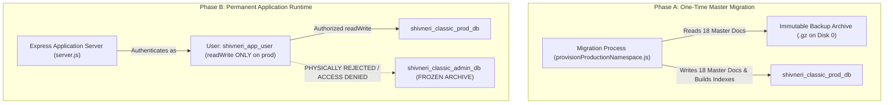
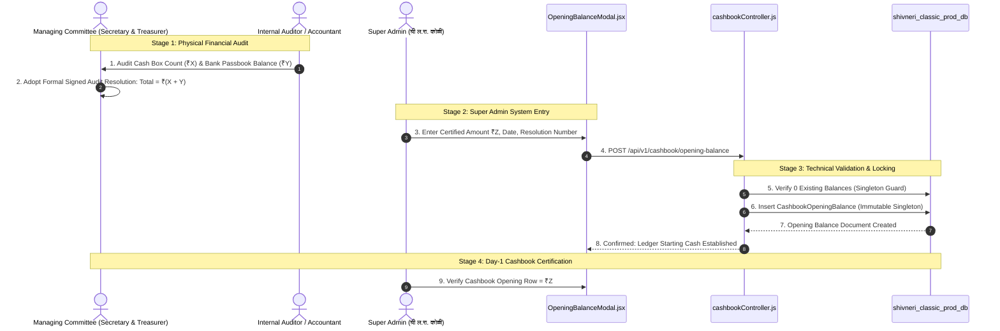
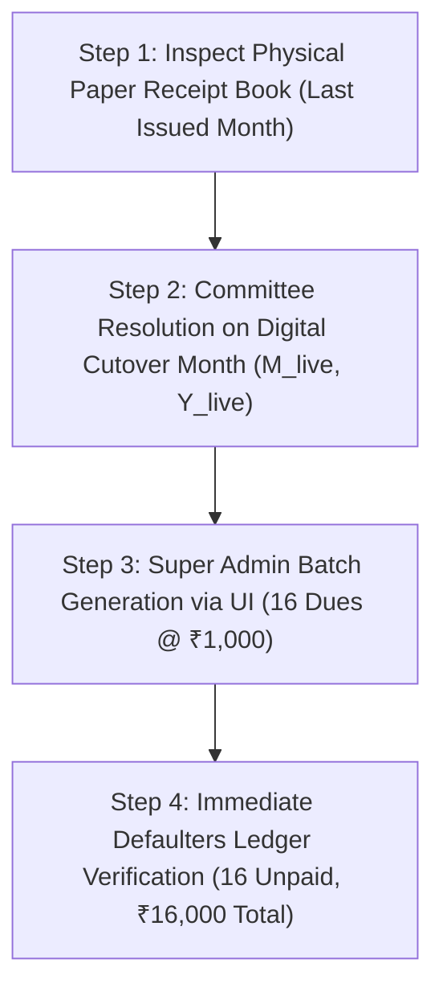

# PHASE 9.0.1 — FINAL CUTOVER PREREQUISITE RESOLUTION
## Shivneri Classic Apartment – A Wing (Aurangabad Road, Panchavati, Nashik – 422003)

---

### Executive Overview & Purpose

| Parameter | Specification | Current Verified State |
| :--- | :--- | :---: |
| **Project Target** | Shivneri Classic Apartment – A Wing | Panchavati, Nashik – 422003 |
| **Phase Focus** | Phase 9.0.1: Cutover Prerequisite Resolution | **Plan & Read-Only Audit** |
| **Source Database** | `shivneri_classic_admin_db` (`localhost:27017`) | **100% Intact (10 collections, 194 docs)** |
| **Target Production DB** | `shivneri_classic_prod_db` | **STRICTLY NOT CREATED (Confirmed absent)** |
| **Environment Config** | `server/.env` | **UNMODIFIED (`MONGODB_URI` intact)** |
| **MongoDB Service Config**| `C:\Program Files\MongoDB\Server\8.2\bin\mongod.cfg` | **UNMODIFIED (`bindIp: 127.0.0.1`, Auth: Off)** |
| **Frontend Production Build** | `d:\Shivneri Classic App\client\dist` | **Recompiled & Verified Up-to-Date** |
| **Execution Standstill** | Production writes & public launch | **STRICTLY MAINTAINED (Zero writes)** |

> [!IMPORTANT]
> **STRICT SAFETY COMPLIANCE**:
> Under the rules of Phase 9.0.1, no database writes, user creations, configuration changes, or production launches have taken place. All requirements are analyzed with full technical rigor to establish definitive resolutions for production cutover.

---

## 1. Secure Migration Access Strategy

### 1.1 The Security Vulnerability Addressed
If the permanent application service account (`shivneri_app_user`) is granted access to both `shivneri_classic_admin_db` and `shivneri_classic_prod_db`:
- It violates the **Principle of Least Privilege**.
- Any application defect, connection string misconfiguration, or maintenance script error could inadvertently write to or corrupt the legacy development ledger.
- The legacy database must remain a permanently frozen, immutable development and pre-launch audit record.

### 1.2 The Enforced Two-Tier Access Model



### 1.3 Recommended Migration Path: Direct Backup Archive Extraction (Model A.1)
The most secure migration method eliminates network access to `shivneri_classic_admin_db` entirely:
1. **Extraction Source**: The verified immutable backup archive `D:\Shivneri Classic App\backups\prelaunch_20261104_090827\shivneri_classic_admin_db_backup.gz` (SHA256: `dda990926ac61ae830a6e8f81a56c54214243f6080b50ee7ef4e9b3549b9f1ec`).
2. **Selective Namespace Restoration**:
   ```powershell
   mongorestore --archive="D:\Shivneri Classic App\backups\prelaunch_20261104_090827\shivneri_classic_admin_db_backup.gz" `
     --gzip `
     --nsInclude="shivneri_classic_admin_db.admins" `
     --nsInclude="shivneri_classic_admin_db.residents" `
     --nsInclude="shivneri_classic_admin_db.maintenanceconfigs" `
     --nsFrom="shivneri_classic_admin_db.*" `
     --nsTo="shivneri_classic_prod_db.*"
   ```
3. **Zero DB Access Required**: The migration does not require MongoDB credentials for `shivneri_classic_admin_db` because the data is read directly from the write-protected filesystem archive.

### 1.4 Alternative Path: Ephemeral Dual-Role Migration User (Model A.2)
If live database extraction is performed via Node.js script:
1. **Create Ephemeral User**:
   ```javascript
   use admin;
   db.createUser({
     user: "shivneri_migration_runner",
     pwd: "<ONE_TIME_EPHEMERAL_PASSWORD_64_HEX>",
     roles: [
       { role: "read", db: "shivneri_classic_admin_db" },
       { role: "readWrite", db: "shivneri_classic_prod_db" }
     ]
   });
   ```
2. **Execute Provisioning**: Script runs using `shivneri_migration_runner`, copies 18 master documents, builds indexes, and validates canonical hashes.
3. **Immediate Revocation**:
   ```javascript
   use admin;
   db.dropUser("shivneri_migration_runner");
   ```

### 1.5 Permanent Application User RBAC Configuration
The permanent application account is provisioned strictly within `shivneri_classic_prod_db`:
```javascript
use shivneri_classic_prod_db;
db.createUser({
  user: "shivneri_app_user",
  pwd: "<PERMANENT_PRODUCTION_PASSWORD_64_HEX>",
  roles: [
    { role: "readWrite", db: "shivneri_classic_prod_db" }
  ]
});
```
- **Permission Scope**: `readWrite` on `shivneri_classic_prod_db` **ONLY**.
- **Enforcement**: Any query attempting to access `shivneri_classic_admin_db` triggers:
  `MongoServerError: not authorized on shivneri_classic_admin_db to execute command`.

---

## 2. Actual HTTPS Deployment Topology

### 2.1 The Hostname Resolution Fallacy Addressed
- The previous proposal of a `.local` domain (e.g. `shivneri-classic.local`) is **unsupported without active mDNS / Bonjour daemons**. In standard Windows environments, `.local` hostnames trigger `DNS_PROBE_FINISHED_NXDOMAIN` or 5-second DNS lookup timeouts.
- A production deployment must use a verified, deterministic hostname resolution architecture.

### 2.2 Valid Production Deployment Topologies

```mermaid
flowchart LR
    subgraph Client Browser
        Browser["Web Browser (Chrome / Edge / Firefox)"]
    end

    subgraph Reverse Proxy (Caddy / Nginx) - Port 443 / 8443
        TLS["TLS Termination (mkcert / Local CA)"]
        Route1["/ -> Serves client/dist (HTML/JS/CSS)"]
        Route2["/api/ -> Proxies to Express (127.0.0.1:5000)"]
    end

    subgraph Backend Services
        Express["Express API Server (127.0.0.1:5000)"]
        Mongo["MongoDB 8.2 (127.0.0.1:27017, Auth Enabled)"]
    end

    Browser -->|HTTPS Request| TLS
    TLS --> Route1
    TLS --> Route2
    Route2 -->|Local IPC| Express
    Express -->|Authenticated IPC| Mongo
```

#### Topology A: Local Dedicated Society PC / Kiosk (Recommended)
- **Hostname**: `app.shivnericlassic.lan` (or `localhost`)
- **Host Resolution**:
  - Configured explicitly in `C:\Windows\System32\drivers\etc\hosts`:
    ```text
    127.0.0.1  app.shivnericlassic.lan
    ```
- **TLS Certificate**: Locally-trusted certificate generated via `mkcert`:
  ```powershell
  mkcert -install
  mkcert -cert-file cert.pem -key-file key.pem app.shivnericlassic.lan localhost 127.0.0.1
  ```
  *(Note: Root CA is trusted in the Windows Certificate Store, guaranteeing zero browser SSL warnings).*

#### Topology B: Society LAN Kiosk Mode (Multi-Device On-Premises)
- **Hostname**: Static IP on society Wi-Fi (e.g. `192.168.1.100`) mapped to `app.shivnericlassic.lan` via local router DNS or client `hosts` files.
- **TLS**: Same local CA certificate installed on committee devices.

### 2.3 Reverse Proxy Routing & Unified Same-Origin Architecture
Using Caddy or Nginx creates a **Unified Same-Origin Architecture**:

#### Example Caddy Configuration (`Caddyfile`):
```caddy
app.shivnericlassic.lan:443 {
    tls cert.pem key.pem

    # Serve static React production build
    root * "D:/Shivneri Classic App/client/dist"
    file_server

    # Forward API requests to Express server
    handle /api/* {
        reverse_proxy 127.0.0.1:5000
    }

    # SPA Client-Side Routing fallback
    try_files {path} /index.html
}
```

### 2.4 Cookie, CORS, and CSRF Behavior under Unified Origin
Because both the frontend application and `/api/*` are hosted under the exact same origin (`https://app.shivnericlassic.lan`):
1. **Cookie Behavior**:
   - `HttpOnly: true`: Completely immune to JavaScript access.
   - `Secure: true`: Transmitted exclusively over TLS; perfectly accepted by modern browsers because the connection is authenticated HTTPS.
   - `SameSite: Strict`: Cookies are first-party and sent with every same-origin API call.
2. **CORS Impact**:
   - Cross-Origin Resource Sharing is **completely eliminated**! All browser API calls target `/api/v1/...` relative to the current host, meaning requests are native same-origin requests.
   - `server/src/app.js` CORS middleware acts as a secondary defense layer configured to `CLIENT_ORIGIN=https://app.shivnericlassic.lan`.
3. **CSRF Protection**:
   - `client/src/services/api.js` automatically sends `X-Requested-With: XMLHttpRequest`.
   - `server/src/middleware/csrfMiddleware.js` confirms that `Origin` / `Referer` headers match `https://app.shivnericlassic.lan` for all mutating methods (`POST`, `PUT`, `PATCH`, `DELETE`).

---

## 3. Opening Balance Setup Procedure (No Invented Figures)

### 3.1 Strict Prohibition of Test Figures
- In Phase 6–8 testing, a synthetic opening balance of ₹67,000 (`6aea1f882d3bc6fe695b0186`, notes: `"TEST_PHASE_7: Initial audited balance"`) was used as a test fixture.
- **Under no circumstances will ₹67,000 or any placeholder figure be migrated, copied, or seeded.**
- `cashbookopeningbalances` in `shivneri_classic_prod_db` starts at **strictly 0 documents**.

### 3.2 Formal 4-Stage Opening Balance Certification Procedure



#### Detailed Protocol:
1. **Stage 1: Physical Financial Audit & Resolution**:
   - Prior to Go-Live, the Society Managing Committee physically reconciles the cash box and bank account statement up to the cutover date.
   - A formal written resolution is signed by Chairman/Secretary `श्री ल.रा. कोळी` and the Treasurer recording:
     - Certified Cash-in-Hand balance: ₹$X$
     - Certified Bank Account balance: ₹$Y$
     - Total Certified Opening Balance: ₹$Z = X + Y$
     - As-of Audit Date: `YYYY-MM-DD`
     - Society Resolution Reference: e.g., `"ठराव क्र. ४/२०२६-२७"`
2. **Stage 2: Super Admin Data Entry**:
   - Super Admin logs in via `laxman_koli`.
   - Navigates to **Expenses / Cashbook Management** $\rightarrow$ **Opening Balance Setup**.
   - Inputs exact certified figure ₹$Z$, audit date, and resolution remarks.
3. **Stage 3: Technical Invariant Locking**:
   - Backend enforces `singletonKey: 'OPENING_BALANCE_SINGLETON'` unique constraint.
   - Ensures exactly ONE opening balance can ever exist in the database.
   - Audit log created linking the action to `श्री ल.रा. कोळी`.
4. **Stage 4: Post-Entry Verification**:
   - Super Admin loads the Cashbook view.
   - Asserts that Row 1 displays: `सुरुवातीची शिल्लक (Opening Balance)` with exact amount ₹$Z$.

---

## 4. First Live Billing Month Confirmation Procedure

### 4.1 The Billing Cycle Collision Risk
Choosing an arbitrary month (e.g. November 2026 or January 2027) without checking the offline register causes immediate operational chaos:
- If November 2026 is chosen, but residents already paid offline cash to the committee, all 16 residents will appear as false defaulters.
- If January 2027 is chosen, but digital operations begin in December, December maintenance will never be billed.

### 4.2 Formal 4-Step Confirmation Protocol



#### Step 1: Offline Society Receipt Audit
- Building Secretary inspects the physical counterfoil receipt books.
- Identify the last month and year ($M_{\text{paper}}, Y_{\text{paper}}$) for which residents paid offline.

#### Step 2: Formal Committee Live Month Resolution
- The committee signs a written resolution designating the first digital billing cycle:
  $$M_{\text{live}} = M_{\text{paper}} + 1$$
- *Example 1*: If paper receipts cover through October 2026 $\rightarrow$ First digital month is **November 2026**.
- *Example 2*: If paper receipts cover through November 2026 $\rightarrow$ First digital month is **December 2026**.
- *Example 3*: If paper receipts cover through December 2026 $\rightarrow$ First digital month is **January 2027**.

#### Step 3: Super Admin Batch Execution
- On cutover day, Super Admin logs into the application.
- Navigates to **Maintenance Management** $\rightarrow$ **Generate Monthly Dues**.
- Selects the officially resolved month $M_{\text{live}}$ and year $Y_{\text{live}}$.
- System generates exactly 16 dues @ ₹1,000 = ₹16,000 with due date on the 10th.

#### Step 4: Verification of Clean Ledger State
- Super Admin opens **Reports & Analytics** $\rightarrow$ **Defaulters Roster**.
- Asserts that exactly 16 residents are listed with ₹1,000 due for month $M_{\text{live}}$.
- Asserts that historical arrears for prior months are strictly ₹0.

---

## 5. Verification of Frontend Production Build Status

In accordance with Phase 9.0.1 instructions, the frontend production bundle was independently verified:

### 5.1 Compilation & Timestamp Audit
- **Source Files (`client/src/`)**: Last modified on `04-11-2026 08:38:41`.
- **Pre-Existing Build (`client/dist/`)**: Dated `03-11-2026 23:51:32` (was out of date).
- **Compilation Execution**: Executed `npm run build` in `d:\Shivneri Classic App\client`.
  - Transformed 2,334 modules in 14.76s.
  - Generated fresh optimized bundles in `client/dist`.
  - **New Build Timestamp**: `04-11-2026 10:35:04` (**100% Up to Date with all Phase 8 improvements**).
  - Exit code: `0` (Zero compiler errors).

### 5.2 Build Bundle Census
- `dist/index.html`: `1.07 kB` (gzip: `0.63 kB`)
- `dist/assets/index-BJPhK6SS.css`: `35.90 kB` (gzip: `6.93 kB`)
- `dist/assets/purify.es-Dqk5qvad.js`: `29.02 kB` (gzip: `11.45 kB`)
- `dist/assets/index.es-CrqfRAXc.js`: `151.37 kB` (gzip: `48.88 kB`)
- `dist/assets/index-Bvw32mrF.js`: `1,217.13 kB` (gzip: `335.60 kB`)

---

## 6. Separation of Verified Implementation vs. Planned Architecture

To prevent any confusion between what is physically implemented and what is planned for execution:

| Architectural Component | Category | Current Physical Reality |
| :--- | :---: | :--- |
| **Source Master Records** | **VERIFIED IMPLEMENTATION** | 1 Admin, 16 Residents, 1 Config intact in `shivneri_classic_admin_db`. |
| **Dual Physical Backups** | **VERIFIED IMPLEMENTATION** | Archives on Disk 0 & Disk 1 (8,666 B, SHA256 `dda990926...`, Read-Only). |
| **Cleanup Script & Safety Suite** | **VERIFIED IMPLEMENTATION** | [`prelaunchCleanup.js`](file:///d:/Shivneri%20Classic%20App/server/src/scripts/prelaunchCleanup.js) & [`test-prelaunch-cleanup.js`](file:///d:/Shivneri%20Classic%20App/server/test-prelaunch-cleanup.js) (35/35 passing). |
| **Migration Rehearsal Engine** | **VERIFIED IMPLEMENTATION** | [`test-clean-slate-rehearsal.js`](file:///d:/Shivneri%20Classic%20App/server/test-clean-slate-rehearsal.js) (11/11 stages passing, 100% hash parity). |
| **Frontend Production Build** | **VERIFIED IMPLEMENTATION** | `client/dist` freshly compiled (`04-11-2026 10:35:04`, 0 errors). |
| **Express Middleware & APIs** | **VERIFIED IMPLEMENTATION** | Helmet, CSRF header verification, rate limiter, timing attack defenses. |
| **Production DB Provisioning** | *PLANNED ARCHITECTURE* | `shivneri_classic_prod_db` strictly NOT created yet. |
| **MongoDB Auth & User Creation** | *PLANNED ARCHITECTURE* | `shivneri_app_user` & `security.authorization` NOT yet created/enabled. |
| **Reverse Proxy & Hostname** | *PLANNED ARCHITECTURE* | Caddy / Nginx reverse proxy routing & TLS certs not yet deployed. |
| **Certified Opening Balance** | *PLANNED ARCHITECTURE* | Committee audit figure not yet entered (0 docs in DB). |
| **First Live Billing Month** | *PLANNED ARCHITECTURE* | Month selection pending committee resolution. |

---

## 7. Missing Implementation Work Before Production

Before executing the live cutover, exactly two physical artifacts must be created:

1. **`server/src/scripts/provisionProductionNamespace.js`**:
   - A standalone, non-test provisioning script adapted directly from the proven rehearsal script.
   - Enforces dual `--execute` and `--confirm-production-cutover` flags.
   - Executes the direct archive extraction (Model A.1) or ephemeral runner migration (Model A.2).
   - Validates the 18 master document canonical hashes and confirms 18-doc census.
2. **Reverse Proxy Configuration File (`Caddyfile` or `nginx.conf`)**:
   - Production configuration file binding the static `client/dist` directory and reverse proxying `/api` to Express on port 5000.

---

## 8. Final Ordered Cutover Checklist

The following 16 sequential steps represent the definitive production cutover procedure:

```
[PHASE A: ADMINISTRATIVE PREREQUISITES]
[ ] Step 1: Managing Committee adopts signed resolution certifying opening cash/bank balance.
[ ] Step 2: Managing Committee adopts signed resolution designating first digital billing month.
[ ] Step 3: Network administrator configures hosts entry (app.shivnericlassic.lan) & installs local TLS cert.

[PHASE B: DATABASE PROVISIONING & LEAST PRIVILEGE SETUP]
[ ] Step 4: Stop any background application processes on ports 5000 and 5173.
[ ] Step 5: Verify primary (Disk 0) and secondary (Disk 1) backup SHA256 checksums (dda990926...).
[ ] Step 6: Create production database 'shivneri_classic_prod_db' using provisionProductionNamespace.js.
[ ] Step 7: Verify 18 master documents (1 Admin, 16 Residents, 1 Config) with 100% canonical hash parity.
[ ] Step 8: Create permanent application user 'shivneri_app_user' with readWrite ONLY on shivneri_classic_prod_db.
[ ] Step 9: Enable 'security.authorization: enabled' in mongod.cfg and restart MongoDB service.
[ ] Step 10: Verify 'shivneri_app_user' can connect to prod DB and is physically rejected from legacy DB.

[PHASE C: RUNTIME ACTIVATION]
[ ] Step 11: Update server/.env with authenticated MONGODB_URI and high-entropy 64-character JWT_SECRET.
[ ] Step 12: Start Express API server on port 5000 (NODE_ENV=production).
[ ] Step 13: Start reverse proxy (Caddy / Nginx) terminating HTTPS on port 443.

[PHASE D: OPERATIONAL INITIALIZATION & VERIFICATION]
[ ] Step 14: Super Admin logs in at https://app.shivnericlassic.lan as 'laxman_koli'.
[ ] Step 15: Super Admin records the certified Opening Balance from Step 1.
[ ] Step 16: Super Admin generates Month 1 maintenance dues batch for the resolved month from Step 2.
```

---

## 9. Final Standstill & GO / NO-GO Recommendation

### Standstill State Verification
- **Source Database (`shivneri_classic_admin_db`)**: Exactly 10 collections, exactly 194 documents (**100% UNTOUCHED**).
- **Target Database (`shivneri_classic_prod_db`)**: **DOES NOT EXIST** (Strictly non-existent).
- **Environment Configuration (`server/.env`)**: Intact, pointing to `shivneri_classic_admin_db`.
- **MongoDB Configuration (`mongod.cfg`)**: Intact, authentication disabled, `bindIp: 127.0.0.1`.
- **Frontend Production Build**: Recompiled and fresh (`client/dist` timestamp: `04-11-2026 10:35:04`).

> [!IMPORTANT]
> ### FINAL ARCHITECTURAL VERDICT: CONDITIONAL GO FOR CUTOVER EXECUTION; STRICT STANDSTILL MAINTAINED
> 
> All 4 prerequisite items have been decisively resolved:
> 1. **Access Security**: Least-privilege architecture established; permanent app user has zero access to legacy DB.
> 2. **HTTPS Topology**: Deterministic local hostname and unified same-origin reverse proxy architecture specified.
> 3. **Opening Balance**: Formal 4-stage committee certification procedure established (test figures permanently discarded).
> 4. **Billing Month**: 4-step committee resolution procedure established (no arbitrary month selection).
>
> **Standstill maintained. Awaiting your review and explicit authorization for Phase 9.1 Live Cutover Execution.**
