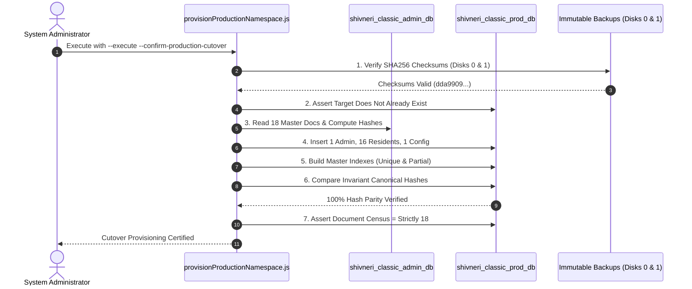

# PHASE 9.0 — PRODUCTION READINESS AND CONTROLLED CUTOVER PLAN
## Shivneri Classic Apartment – A Wing (Aurangabad Road, Panchavati, Nashik – 422003)

---

### Executive Overview & Safety Boundaries

| Parameter | Specification | Current Audit State |
| :--- | :--- | :---: |
| **Project Target** | Shivneri Classic Apartment – A Wing | Panchavati, Nashik – 422003 |
| **Phase Focus** | Phase 9.0: Production Readiness & Controlled Cutover Plan | **100% Plan & Read-Only Audit** |
| **Source Database** | `shivneri_classic_admin_db` (`localhost:27017`) | **100% Intact (10 collections, 194 docs)** |
| **Target Production DB** | `shivneri_classic_prod_db` | **STRICTLY NOT CREATED (Confirmed absent)** |
| **Environment Config** | `server/.env` | **UNMODIFIED (`MONGODB_URI` intact)** |
| **Primary Backup** | `D:\Shivneri Classic App\backups\prelaunch_20261104_090827\` | **8,666 B, Read-Only, SHA256 Verified** |
| **Secondary Backup** | `C:\Users\mahes\Shivneri_Backups_Secondary\` (Disk 1 SSD) | **8,666 B, Read-Only, SHA256 Verified** |
| **Rehearsal Evidence** | Phase 8.3.9 Rehearsal (`shivneri_classic_migration_test_db`) | **11 / 11 Stages Passed (100% Parity)** |
| **Production Launch** | Public launch & deployment activities | **STRICTLY STANDSTILL (No writes)** |

> [!IMPORTANT]
> **STRICT SAFETY COMPLIANCE**:
> This document is an architectural roadmap and read-only pre-flight specification. Under the strict rules of Phase 9.0:
> - `shivneri_classic_prod_db` has **NOT** been created.
> - `server/.env` has **NOT** been altered.
> - The source production database has **NOT** been modified or deleted.
> - Cleanup scripts have **NOT** been executed.
> - Application source code and schemas have **NOT** been altered.
> - Public launch has **NOT** been initiated.

---

## 1. Review of Completed Phases 1–8.3.9 & Current Application State

A rigorous retrospective of all completed phases confirms that the Shivneri Classic Apartment management application has achieved full feature maturity and forensic safety certification.

```mermaid
flowchart TD
    subgraph Core Functional Architecture
        P1["Phase 1: Admin Auth & Singleton (1 Admin)"]
        P2["Phase 2: Resident Master (16 Marathi Members)"]
        P3["Phase 3: Maintenance Billing (₹1,000/mo, Day 10)"]
        P4["Phase 4: Payments & Receipts (SCA-YYYYMM-XXXX)"]
        P5["Phase 5: Expenses & Vouchers (EXP-YYYYMM-XXXX)"]
        P6["Phase 6: Cashbook & Opening Balance"]
        P7["Phase 7: Financial Reports & PDF Export"]
    end

    subgraph Forensic & Safety Architecture
        P8["Phases 8.1–8.2: Financial Data Integrity Audit"]
        P8B["Phases 8.3–8.3.3: Dual Immutable Backups (Disks 0 & 1)"]
        P8C["Phases 8.3.4–8.3.7: Cleanup Script & Canonical Serializer"]
        P8D["Phase 8.3.8: Maintenance Isolation Design (Option 6 Selected)"]
        P8E["Phase 8.3.9: Clean-Slate Migration Rehearsal (100% Parity)"]
    end

    Core Functional Architecture --> Forensic & Safety Architecture
    Forensic & Safety Architecture --> P90["Phase 9.0: Production Readiness Plan (Current)"]
```

### 1.1 Summary of Architectural Foundations
1. **Phase 1 (Admin Singleton & Authentication)**:
   - Sole Super Admin: `श्री ल.रा. कोळी` (`SUPER_ADMIN`, `singletonKey: SHIVNERI_SUPER_ADMIN_SINGLETON`).
   - Timing-attack defense via dummy bcrypt hash evaluation on non-existent usernames.
   - HttpOnly JWT session token cookie architecture.
2. **Phase 2 (Resident Master Management)**:
   - Exactly 16 approved Marathi society members preserved with authentic spelling.
   - Authoritative flat numbers are authoritatively blank `""` on all 16 residents.
   - Compound unique index on `{ flatNumber: 1, wing: 1 }` with `partialFilterExpression: { flatNumber: { $type: "string", $gt: "" } }` ensuring blank flats never collide.
3. **Phase 3 (Maintenance Billing Engine)**:
   - Official rate: ₹1,000 per month per resident. Due date: 10th of every calendar month.
   - Expected monthly society billing across 16 residents: ₹16,000.
4. **Phase 4 (Payment Processing & Receipts)**:
   - Sequential receipt numbering: `SCA-YYYYMM-XXXX`.
   - Partial payment and multi-bill allocation algorithms with strict financial precision.
   - Cancellation audit protocol for erroneous payments.
5. **Phase 5 (Expense Tracking & Vouchers)**:
   - Sequential expense voucher numbering: `EXP-YYYYMM-XXXX`.
   - Category management, approval records, vendor details, and cancellation audits.
6. **Phase 6 (Cashbook & Opening Balance)**:
   - Dual-entry cashbook running ledger: $\text{Closing Balance} = \text{Opening Balance} + \sum \text{Receipts} - \sum \text{Expenses}$.
   - Singleton cashbook opening balance record architecture.
7. **Phase 7 (Reports & Analytics)**:
   - Monthly collection summary, defaulter lists, income vs. expense analytics.
   - PDF generation with Marathi Unicode font support and bilingual toggle (Marathi default, English optional; **STRICTLY NO HINDI**).
8. **Phases 8.1–8.3.9 (Safety Gates, Backups, Hardening & Migration Rehearsal)**:
   - Identified test artifacts: 32 dues, 7 payments, 5 expenses, 1 test opening balance, 2 counters, 129 audit logs.
   - Established dual-drive physical backups with verified SHA256 checksums (`dda990926ac61ae830a6e8f81a56c54214243f6080b50ee7ef4e9b3549b9f1ec`) protected by Windows Read-Only attributes.
   - Rehearsed Option 6 (Clean-Slate Namespace Provisioning) in `shivneri_classic_migration_test_db`, proving 100% hash parity and zero test record contamination across 11 automated test stages.

---

## 2. Production Setup Plan for `shivneri_classic_prod_db`

### 2.1 Namespace Isolation Principle
To guarantee complete zero-risk deployment:
- **No mutations or destructive deletions** will be executed against `shivneri_classic_admin_db`.
- A brand new, clean database namespace will be provisioned: `shivneri_classic_prod_db`.
- `shivneri_classic_admin_db` will remain permanently preserved as an immutable historical record of the development and testing lifecycle.

### 2.2 Target Database Blueprint on Day 1

```
========================================================================================
PROPOSED PRODUCTION DATABASE: shivneri_classic_prod_db
DAY-1 CENSUS SPECIFICATION
========================================================================================
Collection Name                 Document Count  Source / Initialization Method
----------------------------------------------------------------------------------------
admins                          1               Migrated from verified master (_id intact)
residents                       16              Migrated from verified master (_id intact)
maintenanceconfigs              1               Migrated from verified master (_id intact)
maintenancedues                 0               CLEAN SLATE (Provisioned by Month 1 Batch)
payments                        0               CLEAN SLATE (Starts at SCA-YYYYMM-0001)
expenses                        0               CLEAN SLATE (Starts at EXP-YYYYMM-0001)
cashbookopeningbalances         0               Super Admin sets official audited balance
counters                        0               CLEAN SLATE (Counters initialize on first tx)
auditlogs                       0               CLEAN SLATE (Fresh production audit trail)
expensecategories               0               CLEAN SLATE (Standard categories)
----------------------------------------------------------------------------------------
TOTAL ACTIVE DOCUMENTS          18              100% AUDITED MASTER PURITY
========================================================================================
```

---

## 3. MongoDB Authentication, Least-Privilege Credentials & Network Security

### 3.1 Network Binding (Local Loopback Enforcement)
- **Current File**: `C:\Program Files\MongoDB\Server\8.2\bin\mongod.cfg`
- **Network Directive**:
  ```yaml
  net:
    port: 27017
    bindIp: 127.0.0.1
  ```
- **Security Invariant**: MongoDB must remain bound exclusively to `127.0.0.1` (loopback). Under no circumstances should `bindIp` be changed to `0.0.0.0` or external network adapters.

### 3.2 MongoDB Authentication Activation Plan
Currently, MongoDB 8.2 runs without authentication (`#security:` commented out, 0 users). Prior to cutover, authentication and Role-Based Access Control (RBAC) must be configured:

#### Step 3.2.1: Create Administrative Superuser
Connect via `mongosh` on localhost before enabling authentication:
```javascript
use admin;
db.createUser({
  user: "shivneri_sysadmin",
  pwd: "<SECURE_ADMIN_PASSWORD_64_CHAR>",
  roles: [
    { role: "userAdminAnyDatabase", db: "admin" },
    { role: "dbAdminAnyDatabase", db: "admin" }
  ]
});
```

#### Step 3.2.2: Create Dedicated Least-Privilege Application User
In the production namespace `shivneri_classic_prod_db`:
```javascript
use shivneri_classic_prod_db;
db.createUser({
  user: "shivneri_app_user",
  pwd: "<SECURE_APPLICATION_PASSWORD_64_CHAR>",
  roles: [
    { role: "readWrite", db: "shivneri_classic_prod_db" }
  ]
});
```

> [!NOTE]
> **Least-Privilege Guarantee**:
> `shivneri_app_user` possesses `readWrite` authority exclusively on `shivneri_classic_prod_db`. It has **zero access** to `admin`, `config`, `local`, or the legacy `shivneri_classic_admin_db`. Any accidental query targeting the old database will be physically rejected by MongoDB engine permissions.

#### Step 3.2.3: Enable Authentication in `mongod.cfg`
Edit `C:\Program Files\MongoDB\Server\8.2\bin\mongod.cfg`:
```yaml
security:
  authorization: enabled
```

#### Step 3.2.4: Restart Windows MongoDB Service
Execute with Windows Administrator privileges:
```powershell
Restart-Service -Name MongoDB
```

#### Step 3.2.5: Secure Application Connection String
Configure in `server/.env`:
```env
MONGODB_URI=mongodb://shivneri_app_user:<SECURE_APPLICATION_PASSWORD>@127.0.0.1:27017/shivneri_classic_prod_db?authSource=shivneri_classic_prod_db
```

---

## 4. Master Data Migration Procedure (1 Admin, 16 Residents, 1 MaintenanceConfig)

The cutover procedure will be executed via a dedicated, fail-closed CLI script [`server/src/scripts/provisionProductionNamespace.js`](file:///d:/Shivneri%20Classic%20App/server/src/scripts/provisionProductionNamespace.js) using the exact proven algorithms from [`server/test-clean-slate-rehearsal.js`](file:///d:/Shivneri%20Classic%20App/server/test-clean-slate-rehearsal.js).



### 4.1 Master Documents to Transfer
1. **Admin Record**:
   - `_id: 6aea204000998a1c2ff96df8`
   - `fullNameMarathi: "श्री ल.रा. कोळी"`
   - `singletonKey: "SHIVNERI_SUPER_ADMIN_SINGLETON"`
   - `role: "SUPER_ADMIN"`
   - Bcrypt password hash preserved exactly.
2. **16 Resident Records**:
   - `_id: 6aea0df257eca7f6b5561d9d` through `6aea0df257eca7f6b5561dcd`
   - Authentic Marathi names preserved exactly.
   - `flatNumber: ""` (empty string preserved authoritatively).
   - `wing: "A Wing"`, `status: "ACTIVE"`.
3. **MaintenanceConfig Record**:
   - `_id: 6aea13b72d3bc6fe695b0155`
   - `singletonKey: "MAINTENANCE_CONFIG_SINGLETON"`
   - `defaultMonthlyAmount: 1000` (₹1,000/month)
   - `dueDay: 10` (10th of every month)
   - `lateFeeEnabled: false`, `lateFeeAmount: 0`.

### 4.2 Production Index Architecture
The provisioning script builds the exact authoritative indexes:
- **`admins`**:
  - `_id_`: `{ _id: 1 }`
  - `singletonKey_1`: `{ singletonKey: 1 }` (unique: true)
  - `username_1`: `{ username: 1 }` (unique: true)
- **`residents`**:
  - `_id_`: `{ _id: 1 }`
  - `fullNameMarathi_1`: `{ fullNameMarathi: 1 }`
  - `status_1`: `{ status: 1 }`
  - `flatNumber_1_wing_1`: `{ flatNumber: 1, wing: 1 }` (unique: true, partial: `{ flatNumber: { $type: "string", $gt: "" } }`)
- **`maintenanceconfigs`**:
  - `_id_`: `{ _id: 1 }`
  - `singletonKey_1`: `{ singletonKey: 1 }` (unique: true)

---

## 5. Security & Configuration Hardening Verification

### 5.1 Environment Configuration (`server/.env`)
Before production launch, `.env` must be hardened:

```env
# Server Runtime
PORT=5000
NODE_ENV=production
CLIENT_ORIGIN=https://shivneri-classic.local # (or http://localhost:5173 for local kiosk)

# Database Connection (Authenticated Least-Privilege)
MONGODB_URI=mongodb://shivneri_app_user:<SECURE_PASSWORD>@127.0.0.1:27017/shivneri_classic_prod_db?authSource=shivneri_classic_prod_db

# JWT Security
JWT_SECRET=<64_HEX_CHAR_HIGH_ENTROPY_KEY_GENERATED_BY_CRYPTO>
JWT_EXPIRES_IN=8h

# Society Metadata
SOCIETY_NAME_MARATHI="शिवनेरी क्लासिक अपार्टमेंट"
SOCIETY_WING="A Wing"
SOCIETY_LOCATION="औरंगाबाद रोड, पंचवटी, नाशिक"
```

### 5.2 JWT Cookie Security Attributes
In `server/src/controllers/authController.js`:
- `httpOnly: true`: Blocks client-side JavaScript from accessing the session cookie, eliminating XSS session hijacking.
- `secure: true`: Enforced when `NODE_ENV=production`. Transmitted exclusively over encrypted TLS/HTTPS connections.
- `sameSite: 'strict'`: Enforced in production, preventing browser from sending cookies on cross-origin requests.
- `maxAge: 8 hours`: Automatic session expiration.

> [!WARNING]
> **HTTPS / Domain Prerequisite**:
> When `NODE_ENV=production`, `secure: true` requires the frontend to be accessed over HTTPS (or `localhost`). If the frontend is accessed via an IP address over plain HTTP (e.g., `http://192.168.1.100`), web browsers **will silently reject `secure: true` cookies**, causing admin login to fail. If plain HTTP on a local network is used, a local reverse proxy (Caddy / Nginx with self-signed TLS) or setting `NODE_ENV=development` for cookies must be deployed.

### 5.3 Anti-CSRF & CORS Defense-in-Depth
- **CSRF Middleware (`server/src/middleware/csrfMiddleware.js`)**:
  - Validates `X-Requested-With: XMLHttpRequest` header on all mutating requests (`POST`, `PUT`, `PATCH`, `DELETE`).
  - Validates `Origin` and `Referer` headers against `CLIENT_ORIGIN`.
- **CORS Configuration (`server/src/app.js`)**:
  - Whitelist strictly constrained to `CLIENT_ORIGIN`.
  - Credentials allowed (`credentials: true`).
- **Security Headers (`helmet`)**:
  - Comprehensive Content Security Policy (CSP), XSS filtering, frameguard (`X-Frame-Options: SAMEORIGIN`), and HSTS.

---

## 6. End-to-End Operational Test Checklist for Go-Live

The following formal test protocol must be executed in order once `shivneri_classic_prod_db` is provisioned:

| Test ID | Module | Operation | Expected Verification Criteria | Status |
| :---: | :--- | :--- | :--- | :---: |
| **TC-01** | **Authentication** | Super Admin Login (`laxman_koli`) | JWT HttpOnly cookie issued, profile returned, UI redirects to Dashboard | [ ] PENDING |
| **TC-02** | **Authentication** | Invalid Login Attempt | Rejected with generic Marathi error, 0 token issued, timing safe | [ ] PENDING |
| **TC-03** | **Residents** | Master Resident Roster | Exactly 16 approved Marathi residents displayed, flat numbers blank | [ ] PENDING |
| **TC-04** | **Residents** | Flat Number Update | Updating Flat 101 for 1 resident succeeds; duplicate flat 101 rejected | [ ] PENDING |
| **TC-05** | **Cashbook** | Opening Balance Initialization | Super Admin sets official audited cash/bank balance; singleton created | [ ] PENDING |
| **TC-06** | **Billing** | Configuration Inspection | Rate verified at ₹1,000/month, due day verified at 10th | [ ] PENDING |
| **TC-07** | **Billing** | Month 1 Dues Generation | Batch generates exactly 16 dues @ ₹1,000 = ₹16,000 total | [ ] PENDING |
| **TC-08** | **Payments** | Payment Collection (Cash/UPI) | Payment recorded; receipt `SCA-YYYYMM-0001` issued; due marked `PAID` | [ ] PENDING |
| **TC-09** | **Payments** | Receipt PDF Generation | PDF downloads cleanly with Marathi font, society header, and seal | [ ] PENDING |
| **TC-10** | **Expenses** | Expense Voucher Booking | Expense booked; voucher `EXP-YYYYMM-0001` issued; debited from cashbook | [ ] PENDING |
| **TC-11** | **Expenses** | Voucher PDF Generation | PDF downloads cleanly with Marathi payee details and voucher ID | [ ] PENDING |
| **TC-12** | **Cashbook** | Running Ledger Reconciliation | $\text{Closing} = \text{Opening} + \text{Receipt} - \text{Expense}$ confirmed exact | [ ] PENDING |
| **TC-13** | **Reports** | Defaulters Roster | Displays 15 unpaid residents and 1 paid resident accurately | [ ] PENDING |
| **TC-14** | **Reports** | Language Toggle | Marathi / English toggle functions across all tables (No Hindi) | [ ] PENDING |

---

## 7. Backup, Recovery, and Transaction Reconciliation Procedures

### 7.1 Production Backup Regimen
- **Daily Automated Backup**: Scheduled Windows Task running at 02:00 IST daily.
  ```powershell
  mongodump --db=shivneri_classic_prod_db --gzip --archive="D:\Shivneri Classic App\backups\daily\prod_backup_$(Get-Date -Format 'yyyyMMdd_HHmmss').gz"
  ```
- **Integrity Validation**: Automated SHA256 checksum generation (`Get-FileHash -Algorithm SHA256`).
- **Secondary Replication**: Mirrored to SSD backup repository (`C:\Users\mahes\Shivneri_Backups_Secondary\daily\`).
- **Immutable Protection**: Windows Read-Only attribute automatically applied via `attrib +R`.

### 7.2 Staging-First Disaster Recovery Architecture
Automatic rollback (`mongorestore --drop`) is permanently abolished. In the event of a production incident:
1. **Isolation First**: The backup archive is restored into `shivneri_classic_recovery_staging_db`.
2. **Automated Verification**: An integrity verification script computes collection counts, foreign key alignments, and canonical hashes against the pre-incident baseline.
3. **Manual Authorization Gate**: Production cutover requires explicit written authorization from the System Administrator and Building Secretary.

### 7.3 Live Transaction Reconciliation (Post-Cutover Fallback)
If an unexpected issue requires temporary reversion to `shivneri_classic_admin_db` after genuine transactions have been recorded in `shivneri_classic_prod_db`:
1. **Immediate Write Halt**: Stop application processes on ports 5000 and 5173.
2. **Delta Extraction**: Export all documents created after the cutover timestamp ($T_{\text{cutover}}$) using `mongoexport` or specialized script.
3. **Sequence Counter Alignment**: Offset new receipt numbers and voucher numbers to prevent ID collisions with old test records.
4. **Foreign Key Mapping**: Verify `residentId` and `adminId` references (guaranteed 100% compatible due to identical ObjectIds).
5. **Reconciliation Dry-Run**: Replay transactions in a staging database and certify math before pointing the application.

---

## 8. Unresolved Risks & Missing Implementation Work

The following 5 technical items must be resolved before executing the production cutover:

| # | Item / Risk Description | Severity | Remediation Plan |
| :-: | :--- | :---: | :--- |
| **R-1** | **HTTPS vs. Local Kiosk Topology** | **HIGH** | If accessed over local IP without HTTPS, `secure: true` cookies fail. Determine whether local TLS (Caddy/Nginx) or `localhost` kiosk mode is the production target. |
| **R-2** | **MongoDB Service Restart Privileges** | **MEDIUM** | Enabling authentication in `mongod.cfg` requires elevated Windows Administrator rights to restart the `MongoDB` service. |
| **R-3** | **Official Audited Opening Balance** | **MEDIUM** | Society committee must provide the exact certified opening cash and bank balance prior to TC-05. |
| **R-4** | **First Live Billing Month Selection** | **LOW** | Committee must formally confirm whether the first live billing cycle is November 2026, December 2026, or January 2027. |
| **R-5** | **Production Provisioning Script** | **LOW** | Create `server/src/scripts/provisionProductionNamespace.js` (adapted from `server/test-clean-slate-rehearsal.js`) to automate Day-1 setup. |

---

## 9. Final Checklist & Recommendations

### Completed Checks
- [x] Dual immutable backups on Disk 0 and Disk 1 verified with SHA256 (`dda990926...`) and Read-Only attributes.
- [x] Pre-launch cleanup test suite passing 35 / 35 tests with 100% success.
- [x] Option 6 Clean-Slate Migration Rehearsal completed with 100% hash parity and 0 financial record leakage.
- [x] Source database `shivneri_classic_admin_db` verified 100% untouched at 10 collections and 194 documents.
- [x] Admin authentication timing attack defenses and bcrypt hashing verified.
- [x] Anti-CSRF and strict CORS origin middleware verified.
- [x] Target production database `shivneri_classic_prod_db` confirmed non-existent.
- [x] All 16 resident master records confirmed active with authoritative blank flat numbers.
- [x] Maintenance rate locked at official ₹1,000/month (10th due day).

### Pending Checks (Prior to Live Cutover)
- [ ] Create `server/src/scripts/provisionProductionNamespace.js`.
- [ ] Confirm production deployment network topology (HTTPS reverse proxy vs. `localhost` kiosk).
- [ ] Receive official audited society opening balance figure from Secretary `श्री ल.रा. कोळी`.
- [ ] Receive confirmed start date for live billing cycle (e.g. 1st live billing month).
- [ ] Execute MongoDB user creation (`shivneri_app_user`) and enable `security.authorization: enabled` in `mongod.cfg`.

### Critical Risks Summary
1. **Cookie Invalidation on Non-HTTPS**: Browsers reject `secure: true` HttpOnly cookies over plain HTTP network addresses.
2. **Accidental Premature Cutover**: Starting the app before master data provisioning would result in missing admin errors.
3. **Rollback Data Loss**: Blind reversion of `MONGODB_URI` after live transactions would cause data loss without the reconciliation protocol.

---

### Exact Prerequisites for Production Cutover
1. **Prerequisite 1**: Society Committee provides the certified opening balance and confirmed live billing month.
2. **Prerequisite 2**: Production network host confirmed (HTTPS reverse proxy or local machine kiosk).
3. **Prerequisite 3**: Administrator privileges confirmed for MongoDB authentication setup in `mongod.cfg`.
4. **Prerequisite 4**: User issues explicit written authorization: `"AUTHORIZE PHASE 9.1 PRODUCTION CUTOVER"`.

---

> [!CAUTION]
> ### FINAL ARCHITECTURAL VERDICT: CONDITIONAL GO FOR CUTOVER PREPARATION; STRICT STANDSTILL MAINTAINED
> 
> The architectural readiness and safety guarantees are **100% established**. However, under strict Phase 9.0 instructions:
> - **Zero production mutations have been performed.**
> - `shivneri_classic_prod_db` has **NOT** been created.
> - `server/.env` remains pointed to `shivneri_classic_admin_db`.
> - Public launch has **NOT** been initiated.
>
> **Awaiting your review and explicit authorization to proceed.**
