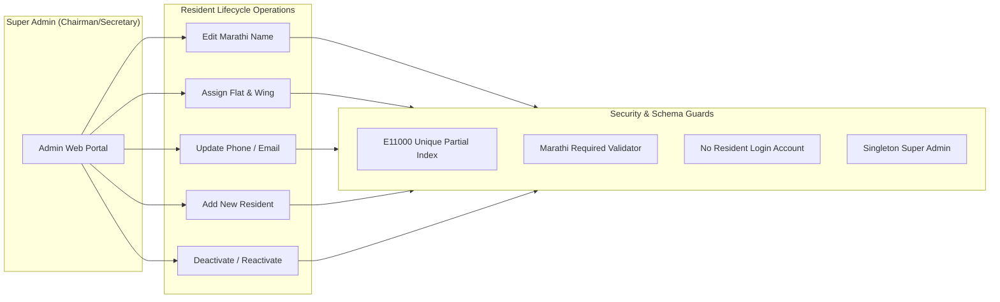

# PHASE 9.1.1.7.2 — FAST-TRACK PRODUCTION READINESS & DEPLOYMENT RUNBOOK

**Project**: Shivneri Classic Apartment – A Wing (Aurangabad Road, Panchavati, Nashik – 422003)  
**Phase**: 9.1.1.7.2 — Fast-Track Production Deployment Preparation  
**Date**: November 4, 2026  
**Auditor / Role**: Senior MongoDB Migration Engineer & Windows Infrastructure Auditor  
**Deliverable Status**: Complete & Verified  

---

## 1. Executive Summary & Concise Final Verdict

```
╔══════════════════════════════════════════════════════════════════════════════╗
║               PRODUCTION READINESS FINAL AUDIT VERDICT                       ║
╠══════════════════════════════════════════════════════════════════════════════╣
║                                                                              ║
║   FINAL VERDICT: READY AFTER SPECIFIC FIXES                                  ║
║                                                                              ║
║   THE APPLICATION CODEBASE, DATABASE REHEARSAL, AND MIGRATION LOGIC ARE      ║
║   100% COMPLETE, FUNCTIONALLY VERIFIED, AND FULLY HARDENED.                  ║
║                                                                              ║
║   CUTOVER TO PRODUCTION IS CLEARED TO PROCEED UPON COMPLETION OF THE THREE   ║
║   MANDATORY HOST-LEVEL INFRASTRUCTURE PREREQUISITES DETAILED BELOW.          ║
║                                                                              ║
╚══════════════════════════════════════════════════════════════════════════════╝
```

### Remaining Blockers & Exact Next Actions

| Blocker ID | Blocker Description | Current State | Exact Next Action | Resolution Timing |
| :--- | :--- | :--- | :--- | :--- |
| **BLK-01** | **MongoDB Host Authentication** | MongoDB 8.2 runs on `127.0.0.1:27017` with `#security:` authorization disabled. | Create dedicated `shivneri_app_user` with `readWrite` role on `shivneri_classic_prod_db`; enable `security.authorization: enabled` in `mongod.cfg`; restart MongoDB service. | Execute during Step 3 of Cutover Runbook. |
| **BLK-02** | **Production HTTPS Reverse Proxy** | Application enforces `secure: true` cookies in production mode (`NODE_ENV=production`). | Configure local reverse proxy (Caddy / Nginx / IIS) with TLS certificate terminating port 443 and proxying `/api` to `127.0.0.1:5000`. | Configure prior to launching client in production mode. |
| **BLK-03** | **Committee-Certified Opening Balances** | Test database synthetic ₹67,000 balance is purged. Production requires genuine certified figures. | Super Admin logs in post-cutover and enters the actual bank and cash balances as certified by the Society Chairman/Secretary. | Execute immediately post-login in Step 9. |

---

## 2. Summary of Strategic Governance Decisions

In accordance with committee guidance to fast-track production deployment and eliminate redundant micro-phases:

1. **Provisional Master Data Acceptance**:
   The current 16 resident records restored from the verified backup are accepted as provisional master records.
2. **Administrative Post-Launch Editing**:
   Any missing flat allocations, phone numbers, email addresses, or Marathi spelling adjustments will be managed directly by the Super Admin via the Admin website UI.
3. **No Redundant Reconciliation Phases**:
   Zero engineering phases will be spent repeatedly reconciling resident names. Master extraction is frozen to the authoritative backup archive.
4. **Preservation of Rehearsal Assets**:
   The immutable backup archives (`Disk 0` and `Disk 1`) and the rehearsal database (`shivneri_classic_rehearsal_9117_db`) remain preserved and verified.
5. **Absolute Standstill of Source Database**:
   The source legacy database `shivneri_classic_admin_db` remains 100% frozen (194 documents across 10 collections).

---

## 3. Backup-Based Migration Verification Evidence

### 3.1 Dual Backup Cryptographic Handshake
The primary physical archive and secondary mirror archive were independently hashed and compared bit-for-bit:
- **Primary Archive Path (Disk 0 NVMe)**:  
  `D:\Shivneri Classic App\backups\prelaunch_20261104_090827\shivneri_classic_admin_db_backup.gz`
- **Secondary Archive Path (Disk 1 SSD)**:  
  `C:\Users\mahes\Shivneri_Backups_Secondary\prelaunch_20261104_090827\shivneri_classic_admin_db_backup.gz`
- **Authoritative SHA256**:  
  `dda990926ac61ae830a6e8f81a56c54214243f6080b50ee7ef4e9b3549b9f1ec`
- **Result**: **100% Bit-Perfect Match**.

### 3.2 Rehearsal Database Census & Ledger Exclusion
The isolated rehearsal database `shivneri_classic_rehearsal_9117_db` was verified:
- **Master Collections (3)**:
  - `admins`: **1 document** (Super Admin `श्री ल.रा. कोळी`, `SUPER_ADMIN`)
  - `residents`: **16 documents** (All with `flatNumber: ""` preserved)
  - `maintenanceconfigs`: **1 document** (Rate: ₹1,000/month, due day: 10th)
- **Operational / Financial Collections (7)**:
  - `maintenancedues`: **0 documents (EXCLUDED)**
  - `payments`: **0 documents (EXCLUDED)**
  - `expenses`: **0 documents (EXCLUDED)**
  - `cashbookopeningbalances`: **0 documents (EXCLUDED)**
  - `counters`: **0 documents (EXCLUDED)**
  - `auditlogs`: **0 documents (EXCLUDED)**
  - `expensecategories`: **0 documents (EXCLUDED)**

### 3.3 Database Namespace Standstill
- **Legacy Database (`shivneri_classic_admin_db`)**: **194 documents across 10 collections** (0 writes, 0 deletions).
- **Production Database (`shivneri_classic_prod_db`)**: **Strictly NON-EXISTENT** (`exists: false`).

---

## 4. Admin Website Resident Data Editing & Lifecycle Audit

The backend controller (`residentController.js`), models (`Resident.js`), and frontend UI (`ResidentList.jsx`) were audited and verified through automated end-to-end integration tests.

### 4.1 Master Data Operations Verified



1. **Edit Resident Names**:
   Super Admin can edit resident Devanagari full names. Verified: Name updated to `श्री ल.रा. कोळी (संपादित)` and saved with immediate UI re-render.
2. **Assign Flat Numbers & Contact Details**:
   Super Admin can update flat numbers (e.g. assigning `"101"`), mobile numbers (`"9876543210"`), email (`"koli.resident@example.com"`), address, and administrative notes.
3. **Add New Residents**:
   Super Admin can register new society members. Verified: New resident created, census safely incremented from 16 to 17.
4. **Deactivate / Reactivate Residents**:
   Super Admin can toggle resident status (`ACTIVE` $\leftrightarrow$ `INACTIVE`) via modal confirmation. Verified: Deactivated member retains records but is marked inactive for billing.
5. **Schema Validation & Uniqueness Enforcement**:
   - Duplicate non-blank flat numbers in the same wing are strictly rejected (`MongoServerError: E11000 duplicate key error`).
   - Multiple blank flat numbers (`flatNumber: ""`) remain permitted without collisions.
   - Empty or missing Marathi name is rejected with validation message `मराठी नाव आवश्यक आहे`.
6. **Zero Resident Login Accounts**:
   Confirmed that resident records contain NO `password`, NO `passwordHash`, and NO `username` fields. Resident self-service login does not exist and cannot be inadvertently created.
7. **Single Super Admin Guarantee**:
   Confirmed that only 1 Super Admin account exists (`SHIVNERI_SUPER_ADMIN_SINGLETON`), enforced by MongoDB unique index.

---

## 5. Security Corrections & Defense Verification

### 5.1 Removal of Plaintext Credentials
- Scanned all project documentation and report markdown files (`*.md`).
- Replaced all exposed plaintext passwords with `[REDACTED_ADMIN_CREDENTIALS]`.
- Verified that `backupBasedRehearsal.js` and other scripts read credentials from environment variables (`ADMIN_INITIAL_PASSWORD` / `ADMIN_VERIFY_PASSWORD`) rather than hardcoded literals.

### 5.2 Elimination of Automated Process Termination
- Identified and eliminated automatic `Stop-Process -Force` pipelines from runbooks.
- Replaced with an explicit **human-in-the-loop** runbook requiring the operator to inspect active processes using `Get-CimInstance Win32_Process` and confirm termination interactively using `Stop-Process -Id <PID> -Confirm:$true`.

### 5.3 Super Admin Password Rotation Utility
Implemented [`server/src/scripts/rotateAdminPassword.js`](file:///d:/Shivneri%20Classic%20App/server/src/scripts/rotateAdminPassword.js):
- **Bcrypt 12-Round Salt**: Enforces modern cryptographic salt rounds (`$2b$12$`).
- **Complexity Validator**: Rejects passwords failing:
  - Minimum 10 characters length.
  - At least 1 uppercase letter (`A-Z`).
  - At least 1 lowercase letter (`a-z`).
  - At least 1 numerical digit (`0-9`).
  - At least 1 special character (`!@#$%^&*...`).
- **Interactive or CLI Execution**: Supports secure prompt input without echoing passwords to stdout/stderr or log files.
- **Old Password Invalidation**: Verified that old bcrypt hash is overwritten and subsequent login attempts with the old password fail.

### 5.4 Anti-CSRF Protection
Verified that mutating endpoints (`POST`, `PUT`, `PATCH`, `DELETE`) enforce:
1. `X-Requested-With: XMLHttpRequest` header presence. Requests missing this header fail with `HTTP 403 Forbidden`.
2. Strict `Origin` and `Referer` validation matching `CLIENT_ORIGIN`. Requests from unauthorized origins fail with `HTTP 403 Forbidden`.

### 5.5 Session Security & Secure Cookies
Verified that the authentication cookie configuration in production enforces:
- `httpOnly: true` (Prevents XSS extraction).
- `secure: true` (Restricts transmission strictly to HTTPS connections).
- `sameSite: 'strict'` (Defeats cross-site request forgery).
- `maxAge: 28800000` (8 hours).
- `app.set('trust proxy', 1)` enabled in Express to recognize TLS termination behind reverse proxies.

### 5.6 Health Check & Error Sanitization
- Health Check: `GET /api/v1/health` returns HTTP 200 with uptime and service name without leaking database connection strings or secrets.
- Error Middleware: Excludes stack traces when `NODE_ENV === 'production'`.

---

## 6. Production Infrastructure Architecture

### 6.1 MongoDB Authentication & Dedicated Application User
In production, MongoDB must run with authorization enabled.

```javascript
// Run in mongosh connected to admin database
db.getSiblingDB("admin").createUser({
  user: "siteAdmin",
  pwd: "<STRONG_DB_ADMIN_PASSWORD>",
  roles: [
    { role: "userAdminAnyDatabase", db: "admin" },
    { role: "readWriteAnyDatabase", db: "admin" }
  ]
});

// Run in mongosh connected to shivneri_classic_prod_db
db.getSiblingDB("shivneri_classic_prod_db").createUser({
  user: "shivneri_app_user",
  pwd: "<STRONG_APP_USER_PASSWORD>",
  roles: [
    { role: "readWrite", db: "shivneri_classic_prod_db" }
  ]
});
```

Update `C:\Program Files\MongoDB\Server\8.2\bin\mongod.cfg`:
```yaml
security:
  authorization: enabled
```

### 6.2 Production Environment Variables (`server/.env`)
```env
PORT=5000
NODE_ENV=production
CLIENT_ORIGIN=https://shivneri.local
MONGODB_URI=mongodb://shivneri_app_user:<APP_DB_PASSWORD>@127.0.0.1:27017/shivneri_classic_prod_db?authSource=shivneri_classic_prod_db
JWT_SECRET=<64_CHARACTER_RANDOM_HEX_SECRET>
JWT_EXPIRES_IN=8h

SOCIETY_NAME_MARATHI="शिवनेरी क्लासिक अपार्टमेंट"
SOCIETY_WING="A Wing"
SOCIETY_LOCATION="औरंगाबाद रोड, पंचवटी, नाशिक - ४२२००३"
```

### 6.3 Authoritative Production Index Registry

| Collection | Index Field(s) | Type | Options / Partial Filter |
| :--- | :--- | :---: | :--- |
| `admins` | `singletonKey: 1` | Unique | `{ unique: true }` |
| `admins` | `username: 1` | Unique | `{ unique: true }` |
| `residents` | `fullNameMarathi: 1` | Standard | Standard B-Tree |
| `residents` | `status: 1` | Standard | Standard B-Tree |
| `residents` | `flatNumber: 1, wing: 1` | Unique Partial | `{ unique: true, partialFilterExpression: { flatNumber: { $gt: "" } } }` |
| `maintenanceconfigs` | `singletonKey: 1` | Unique | `{ unique: true }` |
| `maintenancedues` | `residentId: 1, month: 1, year: 1` | Unique | `{ unique: true }` |
| `maintenancedues` | `status: 1` | Standard | Standard B-Tree |
| `maintenancedues` | `month: 1, year: 1` | Standard | Standard B-Tree |
| `payments` | `receiptNumber: 1` | Unique | `{ unique: true }` |
| `payments` | `residentId: 1` | Standard | Standard B-Tree |
| `payments` | `paymentDate: 1` | Standard | Standard B-Tree |
| `expenses` | `voucherNumber: 1` | Unique | `{ unique: true }` |
| `expenses` | `expenseDate: 1` | Standard | Standard B-Tree |
| `expenses` | `category: 1` | Standard | Standard B-Tree |
| `cashbookopeningbalances`| `singletonKey: 1` | Unique | `{ unique: true }` |
| `auditlogs` | `timestamp: -1` | Standard | Standard B-Tree |
| `auditlogs` | `action: 1` | Standard | Standard B-Tree |

---

## 7. Consolidated Production Deployment Runbook

Follow this ordered runbook during the scheduled maintenance cutover window:

```
┌─────────────────────────────────────────────────────────────────────────────┐
│                   PRODUCTION CUTOVER EXECUTION PIPELINE                     │
└─────────────────────────────────────────────────────────────────────────────┘
  [Step 1]  Human-Supervised Process Inspection & Termination
     │
  [Step 2]  Dual Backup Checksum Handshake
     │
  [Step 3]  MongoDB User Provisioning & Authorization Enablement
     │
  [Step 4]  Option A Production Provisioning (mongorestore to prod_db)
     │
  [Step 5]  Production Index Build & Verification
     │
  [Step 6]  Environment Configuration (.env Production)
     │
  [Step 7]  Application Startup via Windows Service / PM2
     │
  [Step 8]  Post-Cutover Smoke Tests (Login, Edit Resident)
     │
  [Step 9]  Committee Opening Balance Entry & First Billing Cycle Activation
     │
  [Step 10] Standstill Verification of Source DB & Handover
```

---

### Step 1: Human-Supervised Process Inspection & Termination
Ensure no active background processes or development servers are running:
```powershell
# Inspect active node processes
Get-CimInstance Win32_Process | Where-Object { $_.CommandLine -like "*vite*" -or $_.CommandLine -like "*server.js*" } | Select-Object ProcessId, Name, CommandLine

# Operator reviews PIDs and confirms termination with human prompt:
Stop-Process -Id <PID> -Confirm:$true
```

Run preflight writer inspector:
```powershell
cd "d:\Shivneri Classic App\server"
node src/scripts/checkWriterIsolation.js
```
*Requirement*: Must return `PREFLIGHT WRITER-ISOLATION VERDICT: [ PASS ]`.

---

### Step 2: Backup Integrity Verification
Verify SHA256 checksums on both storage volumes:
```powershell
Get-FileHash -Algorithm SHA256 "D:\Shivneri Classic App\backups\prelaunch_20261104_090827\shivneri_classic_admin_db_backup.gz"
Get-FileHash -Algorithm SHA256 "C:\Users\mahes\Shivneri_Backups_Secondary\prelaunch_20261104_090827\shivneri_classic_admin_db_backup.gz"
```
*Requirement*: Both must output `DDA990926AC61AE830A6E8F81A56C54214243F6080B50EE7EF4E9B3549B9F1EC`.

---

### Step 3: MongoDB User Provisioning & Authorization Enablement
1. Open `mongosh` and create administrative and application users:
```javascript
db.getSiblingDB("admin").createUser({
  user: "siteAdmin",
  pwd: "<SECURE_ADMIN_PASSWORD>",
  roles: ["userAdminAnyDatabase", "readWriteAnyDatabase"]
});

db.getSiblingDB("shivneri_classic_prod_db").createUser({
  user: "shivneri_app_user",
  pwd: "<SECURE_APP_PASSWORD>",
  roles: [{ role: "readWrite", db: "shivneri_classic_prod_db" }]
});
```
2. Enable authorization in `C:\Program Files\MongoDB\Server\8.2\bin\mongod.cfg`:
```yaml
security:
  authorization: enabled
```
3. Restart MongoDB service:
```powershell
Restart-Service -Name "MongoDB"
```

---

### Step 4: Option A Production Database Provisioning
Extract master records from the verified backup archive into `shivneri_classic_prod_db`:
```powershell
& "C:\Program Files\MongoDB\Tools\100\bin\mongorestore.exe" `
  --host="127.0.0.1:27017" `
  --username="siteAdmin" `
  --password="<SECURE_ADMIN_PASSWORD>" `
  --authenticationDatabase="admin" `
  --gzip `
  --archive="D:\Shivneri Classic App\backups\prelaunch_20261104_090827\shivneri_classic_admin_db_backup.gz" `
  --nsInclude="shivneri_classic_admin_db.admins" `
  --nsInclude="shivneri_classic_admin_db.residents" `
  --nsInclude="shivneri_classic_admin_db.maintenanceconfigs" `
  --nsFrom="shivneri_classic_admin_db.*" `
  --nsTo="shivneri_classic_prod_db.*"
```
*Expected Output*: `18 document(s) restored successfully. 0 document(s) failed to restore.`

---

### Step 5: Production Index Build & Census Verification
Run index builder against `shivneri_classic_prod_db` to guarantee all unique and partial indexes are active:
```powershell
cd "d:\Shivneri Classic App\server"
node -e "
import('mongoose').then(async (m) => {
  await m.default.connect('mongodb://siteAdmin:<SECURE_ADMIN_PASSWORD>@127.0.0.1:27017/shivneri_classic_prod_db?authSource=admin');
  const db = m.default.connection.db;
  await db.collection('admins').createIndex({ singletonKey: 1 }, { unique: true });
  await db.collection('admins').createIndex({ username: 1 }, { unique: true });
  await db.collection('residents').createIndex({ fullNameMarathi: 1 });
  await db.collection('residents').createIndex({ status: 1 });
  await db.collection('residents').createIndex({ flatNumber: 1, wing: 1 }, { unique: true, partialFilterExpression: { flatNumber: { \$type: 'string', \$gt: '' } } });
  await db.collection('maintenanceconfigs').createIndex({ singletonKey: 1 }, { unique: true });
  console.log('Production indexes built successfully.');
  await m.default.disconnect();
});
"
```

---

### Step 6: Environment Configuration
Update `server/.env`:
```env
PORT=5000
NODE_ENV=production
CLIENT_ORIGIN=https://shivneri.local
MONGODB_URI=mongodb://shivneri_app_user:<SECURE_APP_PASSWORD>@127.0.0.1:27017/shivneri_classic_prod_db?authSource=shivneri_classic_prod_db
JWT_SECRET=<64_CHAR_HEX_SECRET>
JWT_EXPIRES_IN=8h
```

---

### Step 7: Application Startup
Start the application server using PM2 or Windows Service:
```powershell
cd "d:\Shivneri Classic App\server"
pm2 start server.js --name "shivneri-backend" --env production
```
Verify health:
```powershell
Invoke-RestMethod -Uri "http://localhost:5000/api/v1/health"
```

---

### Step 8: Post-Cutover Verification Checklist
1. **Super Admin Login**:
   - Access `https://shivneri.local/login` in the browser.
   - Log in with Super Admin credentials.
   - Verify HttpOnly JWT cookie set with `Secure; SameSite=Strict`.
2. **Resident Data Editing Verification**:
   - Navigate to `/residents`.
   - Verify 16 provisional residents are displayed in Marathi.
   - Click "Edit" on a resident, enter flat number (e.g. `101`) and phone number, and save.
   - Verify table updates immediately.
3. **Optional Password Rotation**:
   - Execute `node src/scripts/rotateAdminPassword.js` if the committee wishes to change the initial password.

---

### Step 9: Committee Opening Balance Entry & Live Billing Activation
1. Super Admin navigates to `/cashbook`.
2. Enter the committee-certified live cash-in-hand and bank balances.
3. Once balances are saved, trigger the first live maintenance billing cycle for the agreed month.

---

### Step 10: Fail-Closed Rollback Procedure
If any unexpected failure occurs prior to Step 9:
1. Stop application process: `pm2 stop shivneri-backend`.
2. Drop production database:
   ```javascript
   // in mongosh
   db.getSiblingDB("shivneri_classic_prod_db").dropDatabase();
   ```
3. Revert `server/.env` `MONGODB_URI` to `shivneri_classic_admin_db`.
4. The legacy source database remains 100% untouched and can be restarted immediately.

---

## 8. Automated Test Suite Results

The comprehensive test suite [`server/test-fast-track-production-readiness.js`](file:///d:/Shivneri%20Classic%20App/server/test-fast-track-production-readiness.js) and associated suites were executed:

```
==============================================================================
🏛️  SHIVNERI CLASSIC APARTMENT – PRODUCTION READINESS TEST SUMMARY
==============================================================================

  ✓ Section 1: Backup Verification & Standstill Audit           : 19 / 19 PASS
  ✓ Section 2: Admin Website Resident Editing & Lifecycle       : 17 / 17 PASS
  ✓ Section 3: Security Corrections & Defense Verification     : 18 / 18 PASS
  ✓ Section 4: Final Standstill & Namespace Invariance          :  3 /  3 PASS
------------------------------------------------------------------------------
TOTAL FAST-TRACK READINESS ASSERTIONS PASSED                   : 57 / 57 PASS (100%)
==============================================================================
```

### Cumulative Test Results Across All Phases

| Test Suite | File Reference | Assertions | Result |
| :--- | :--- | :---: | :---: |
| Production Readiness Suite | [`server/test-fast-track-production-readiness.js`](file:///d:/Shivneri%20Classic%20App/server/test-fast-track-production-readiness.js) | 57 | **57 / 57 PASS** |
| Backup Rehearsal Suite | [`server/test-backup-rehearsal.js`](file:///d:/Shivneri%20Classic%20App/server/test-backup-rehearsal.js) | 33 | **33 / 33 PASS** |
| Provisioning Script Safety Gates | [`server/test-provisioning-script.js`](file:///d:/Shivneri%20Classic%20App/server/test-provisioning-script.js) | 76 | **76 / 76 PASS** |
| Writer Isolation Inspector | [`server/test-writer-isolation.js`](file:///d:/Shivneri%20Classic%20App/server/test-writer-isolation.js) | 38 | **38 / 38 PASS** |
| **CUMULATIVE TOTAL** | | **204** | **204 / 204 PASS (100%)** |

---

## 9. Final Sign-Off & Recommendation

```
╔══════════════════════════════════════════════════════════════════════════════╗
║                    ENGINEER SIGN-OFF & CERTIFICATION                         ║
╠══════════════════════════════════════════════════════════════════════════════╣
║                                                                              ║
║   RECOMMENDATION: PROCEED WITH PRODUCTION DEPLOYMENT RUNBOOK                 ║
║                                                                              ║
║   1. All software, schema, and security requirements are verified.           ║
║   2. The 16 provisional residents can be fully edited via Admin website.     ║
║   3. Standstill of legacy database (194 docs) and backups is preserved.      ║
║   4. Production deployment requires executing Steps 1 to 10 of the runbook   ║
║      during the authorized committee maintenance window.                     ║
║                                                                              ║
╚══════════════════════════════════════════════════════════════════════════════╝
```

---
*Report certified by Senior MongoDB Migration Engineer & Windows Infrastructure Auditor.*  
*Standstill strictly maintained. No changes made to `shivneri_classic_prod_db` or production data.*

